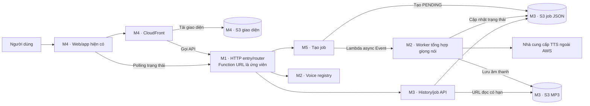

<div align="center">
  

  <p>
    
    &nbsp;&nbsp;&nbsp;
    
  </p>

  <p>
    
    
    
    
  </p>

  <p><strong>Đồ án học phần Điện Toán Đám Mây - chuyển văn bản thành giọng nói đa ngôn ngữ.</strong></p>
</div>


## Mục lục

- [Giới thiệu](#giới-thiệu)
- [Luồng chuyển văn bản thành MP3](#luồng-chuyển-văn-bản-thành-mp3)
- [Phân chia module](#phân-chia-module)
- [Cấu hình AWS trong repo](#cấu-hình-aws-trong-repo)
- [Bắt đầu tìm hiểu repo](#bắt-đầu-tìm-hiểu-repo)
- [Cấu trúc thư mục](#cấu-trúc-thư-mục)
- [Trạng thái và giới hạn hiện tại](#trạng-thái-và-giới-hạn-hiện-tại)

## Giới thiệu

Dự án hướng tới việc để người dùng nhập văn bản, chọn ngôn ngữ và giọng đọc, sau đó nhận tệp MP3 để nghe hoặc tải xuống. Web và app hiện có source trong repo; công việc tập trung vào tích hợp backend và triển khai trên AWS Academy Sandbox.

Ngôn ngữ mục tiêu là tiếng Việt, tiếng Anh và tiếng Nhật, tùy theo voice thực tế mà nhà cung cấp hỗ trợ và nhóm xác minh được. Gemini hỗ trợ đề xuất sửa lỗi đánh máy là hạng mục **MR sau MVP**, không tự sửa nội dung trước khi người dùng chấp nhận.

## Luồng chuyển văn bản thành MP3

Sơ đồ thể hiện kiến trúc mục tiêu và ownership của từng module. Các thành phần AWS vẫn là phương án đề xuất cần kiểm chứng.



1. Người dùng nhập nội dung trên web/app M4.
2. Yêu cầu đi qua HTTP entry M1 đến submit M5. Job mới được lưu ở trạng thái `PENDING`; API dự kiến trả `202 Accepted` và mã job.
3. M5 gửi sự kiện Lambda bất đồng bộ cho worker M2. Worker gọi nhà cung cấp TTS, lưu MP3 và cập nhật job qua thành phần dữ liệu của M3.
4. Web/app hỏi trạng thái job. Khi hoàn tất, API trả thông tin MP3 và URL đọc có thời hạn.

Lambda async Event là cơ chế sự kiện của Lambda, **không phải SQS**. Bucket giao diện M4 tách biệt với nơi lưu job và audio của M3.

## Phân chia module

| Module | Thành viên | Phạm vi chính |
|---|---|---|
| M1 | Minh Lý | HTTP entry/router, root SAM, kiểm tra capability và giám sát chung |
| M2 | Trung Khang | Provider TTS, voice registry, worker và tạo MP3 |
| M3 | Trung Đức | S3 jobs/audio, common repository, history và presigned URL |
| M4 | Nguyên Khang | Tích hợp web/app hiện có, hosting S3/CloudFront |
| M5 | Trung Nghĩa | Submit, điều phối async, recovery, telemetry và tests; typo/stats là MR |

Chi tiết nhiệm vụ, phụ thuộc và tiêu chí bàn giao nằm trong [task của từng module](docs/README.md#task-theo-thành-viên). Phạm vi phối hợp liên module được tóm tắt trong [backlog](docs/plans/MODULE-BACKLOG-AND-ACCEPTANCE.md).

## Cấu hình AWS trong repo

| File | Chức năng | Hiện trạng |
|---|---|---|
| [`samconfig.toml`](samconfig.toml) | Tham số mặc định cho AWS SAM CLI, gồm stack `tts-dev` và region `us-east-1`. | Chỉ chỉ dẫn cho CLI; không tự mô tả hay tạo tài nguyên. |
| [`template.yaml`](template.yaml) | SAM/CloudFormation template mô tả tài nguyên dự kiến. | Còn skeleton với SSM parameter `ProjectMarker`; chưa phải template triển khai TTS hoàn chỉnh. **Không deploy skeleton này.** |

SAM CLI dùng `samconfig.toml` cùng template được chỉ định để build/deploy. Có hai file này không đồng nghĩa hệ thống AWS đã được dựng. Xem [hướng dẫn deploy](docs/guides/DEPLOY.md) và xác nhận capability trước mọi thao tác Sandbox.

## Bắt đầu tìm hiểu repo

### Thành viên nhóm

1. Đọc README này và [sơ đồ kiến trúc](docs/overview/ARCHITECTURE.md) để nắm luồng tổng thể.
2. Đọc [quy ước API và dữ liệu](docs/overview/QUY-UOC-CHUNG.md) để hiểu contract giữa module.
3. Đọc `AGENTS.md`, log cá nhân và **toàn bộ task của module mình** trước khi nhận việc.

| Module | Task | Nhật ký |
|---|---|---|
| M1 | [task-m1.md](docs/tasks/task-m1.md) | `logs/log-m1.md` |
| M2 | [task-m2.md](docs/tasks/task-m2.md) | `logs/log-m2.md` |
| M3 | [task-m3.md](docs/tasks/task-m3.md) | `logs/log-m3.md` |
| M4 | [task-m4.md](docs/tasks/task-m4.md) | `logs/log-m4.md` |
| M5 | [task-m5.md](docs/tasks/task-m5.md) | `logs/log-m5.md` |

### Agent hỗ trợ thành viên

Đọc `AGENTS.md`, README, [bản đồ tài liệu](docs/README.md), kiến trúc, quy ước chung, log và task đầy đủ của module đang làm. Chỉ mở các tài liệu chi tiết trong [`docs/plans/`](docs/plans/README.md) hoặc guides khi task cần thông tin tương ứng; không cần đọc cả thư mục plans.

### Tài liệu theo nhu cầu

- [Bản đồ toàn bộ docs](docs/README.md)
- [Kế hoạch Sandbox](docs/plans/README.md)
- [Deploy và redeploy](docs/guides/DEPLOY.md)
- [Git và nhật ký](docs/guides/GIT-VA-LOGS.md)
- [Khung báo cáo](docs/guides/KHUNG-BAO-CAO.md)

## Cấu trúc thư mục

```text
.
├── backend/                 # Lambda handlers và common Python
├── frontend/
│   ├── web/                 # Web app React/Vite và public assets
│   └── app/                 # Ứng dụng Expo/React Native
├── config/                  # Cấu hình mục tiêu và voice registry
├── infra/                   # Các phần hạ tầng theo module
├── docs/
│   ├── overview/            # Kiến trúc và contract chung
│   ├── tasks/               # Phân công chi tiết M1–M5
│   ├── plans/               # Kế hoạch và tài liệu tham chiếu
│   └── guides/              # Deploy, Git/log và báo cáo
├── logs/                    # Nhật ký từng thành viên
├── samconfig.toml           # Tham số AWS SAM CLI
└── template.yaml            # SAM/CloudFormation skeleton
```

## Trạng thái và giới hạn hiện tại

- Kiến trúc Sandbox đang đề xuất, chờ nhóm duyệt; repo chưa deploy lên AWS.
- Backend/common/provider còn stub hoặc TODO; một số handler chưa triển khai logic runtime.
- Mục tiêu region là `us-east-1`; cấu hình mục tiêu chưa làm runtime sẵn sàng để deploy.
- Quyền Function URL, Lambda Invoke, CloudFront OAC, CloudFormation và cơ chế lưu secret cần xác minh. Nếu không có cách bảo vệ API key được chấp thuận, tiếp tục bằng mocks.
- Polly, DynamoDB, API Gateway, SQS/DLQ, Secrets Manager, Comprehend, Translate, Cognito, X-Ray/RUM, EventBridge và Budgets đang ngoài baseline Sandbox.
- AWS Academy Sandbox có thể reset tài nguyên khi phiên lab kết thúc. Không lưu credentials, API key, token hoặc URL presigned đầy đủ trong repo, log hay ảnh chụp.

<div align="center">
  <sub>Đồ án Multilingual TTS · HCMUTE · AWS Academy Sandbox</sub>
</div>
