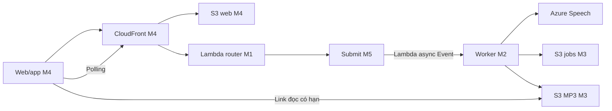

<div align="center">
  

  <p>
    
    &nbsp;&nbsp;&nbsp;
    
  </p>

  <p>
    
    
    
    
  </p>

  <p><strong>Đồ án học phần Điện Toán Đám Mây - chuyển văn bản thành giọng nói đa ngôn ngữ.</strong></p>
</div>


## Chạy bản demo Azure

Azure Speech là provider mặc định. AWS Academy chạy Lambda, S3 jobs/audio và CloudFront; web React và app Expo dùng cùng API. Hướng dẫn cho cả năm thành viên nằm trong **[Azure Speech → AWS Sandbox → Web/App](docs/guides/AZURE-SPEECH.md)**, gồm tạo Speech F0, kiểm region Students, mã demo, kiểm MP3, lỗi và dựng lại sau reset.

Trong CloudShell của lab đang hoạt động ở us-east-1, sau khi lấy đúng code:

```bash
python3 scripts/azure.py configure --region eastasia
python3 scripts/azure.py plan
```

Configure hỏi key kín, lưu SSM và lấy catalog thật. Plan chọn CREATE khi chưa có stack hoặc UPDATE khi stack sẵn sàng. **Review changeset trước khi tiếp tục:**

```bash
python3 scripts/azure.py apply
bash scripts/sandbox.sh web
```

Mở link CloudFront vừa in. Chủ lab lấy mã bằng `bash scripts/sandbox.sh ma` và nhập vào Cài đặt trên web; không đăng mã lên Git/chat công khai. Thử một câu ngắn, phát/tải MP3 và kiểm lịch sử. Resource Azure ở vùng khác thì dùng đúng vùng đó thay eastasia; AWS vẫn us-east-1.

Lệnh tạo/cập nhật chỉ chạy trên lab được giao. Script không tự xóa stack lỗi. Không tạo IAM role/policy/OIDC, không xuất AWS credentials ra laptop hoặc đặt key vào frontend.

## Luồng xử lý



Job mới trả 202 rồi PENDING → PROCESSING → DONE/FAILED. Worker đọc key qua SSM SecureString, gọi Azure, lưu MP3/metadata; frontend nhận URL có hạn để phát/tải. Jobs/audio/web là ba bucket riêng; bucket artifact dùng đóng gói code. Không dùng Polly, DynamoDB, API Gateway hay SQS trong bản Sandbox này.

## Cấu trúc code

| Thư mục/file | Nội dung |
|---|---|
| backend/http, submit, synthesize, voices, history, stats | Lambda theo module; stats chưa bật đầy đủ |
| backend/common/python/tts_common | Layer dùng chung: S3 repository, dữ liệu và catalog |
| backend/synthesize/providers | Azure/ElevenLabs adapter; common chứa đọc key, kiểm MP3 và chặn redirect |
| config | Giới hạn và registry nguồn; Azure registry sinh bằng configure |
| frontend/web, frontend/app | Giao diện React/Vite và Expo/React Native |
| infra, template.yaml | Năm stack con và root CloudFormation/SAM |
| scripts/azure.py | Cấu hình và review/deploy Azure cho stack mới hoặc hiện có |
| scripts/sandbox.sh | Upload web, lấy mã, smoke HTTP và alias configure/plan |
| docs, logs | Hướng dẫn, task, kế hoạch tham chiếu và bằng chứng từng người |

Hai bản registry Azure ở config và Layer là cần thiết để đóng gói Lambda; configure giữ chúng đồng bộ. Không sửa thủ công chỉ một bản. Adapter ElevenLabs còn cho dữ liệu/kiểm thử cũ, không phải mặc định deploy.

## Thành viên và tài liệu

| Module | Người phụ trách | Phạm vi | Task |
|---|---|---|---|
| M1 | Minh Lý | Router, root SAM, LabRole capability, CloudWatch/SNS | [M1](docs/tasks/task-m1.md) |
| M2 | Trung Khang | Provider, voices, worker, MP3, async retry config | [M2](docs/tasks/task-m2.md) |
| M3 | Trung Đức | S3 jobs/audio, common repository, history/presign | [M3](docs/tasks/task-m3.md) |
| M4 | Nguyên Khang | Web/app, CloudFront/OAC, upload/reset | [M4](docs/tasks/task-m4.md) |
| M5 | Trung Nghĩa | Submit, async orchestration/recovery, telemetry/tests | [M5](docs/tasks/task-m5.md) |

Trước khi sửa đọc AGENTS.md, [kiến trúc](docs/overview/ARCHITECTURE.md), [quy ước API](docs/overview/QUY-UOC-CHUNG.md), task đầy đủ và log module mình. [Bản đồ docs](docs/README.md) dẫn tài liệu theo nhu cầu; plans giữ lịch sử quyết định, không phải trạng thái deploy hiện tại.

Chạy frontend local và kiểm tra: [frontend/README.md](frontend/README.md). Region, tên parameter và nhận diện token: [hướng dẫn cả nhóm](docs/guides/AZURE-SPEECH.md).

## Trạng thái và giới hạn

- Ngày 08/11/2026, Nguyên Khang tự cập nhật stack hiện có sang Azure, upload web và báo thử được trên web. Agent không gọi AWS/provider trong quá trình chuẩn bị code.
- Bản script thống nhất CREATE/UPDATE và cleanup mới được kiểm thử local; quyền/tài nguyên và luồng native cần kiểm lại ở mỗi lab/thiết bị.
- Registry ban đầu chưa cấu hình: mỗi lab chạy configure bằng key/vùng được cấp; không coi tên giọng mẫu là dịch vụ đã hoạt động.
- Giới hạn hiện tại: 2.000 ký tự/job, tốc độ 0,7–1,2 (mặc định 0,9), 6.000 ký tự/ngày cho scope demo chung; quota Azure tính riêng.
- Dịch/Gemini/stats đầy đủ chưa bật. Shared demo token không cung cấp tài khoản hoặc dữ liệu tách riêng cho từng người.
- Academy Cloud Foundations Sandbox dọn tài nguyên/data cuối phiên theo README lab. Lưu source/evidence đã che dữ liệu ngoài lab, không backup credentials/token hoặc presigned URL đầy đủ.
