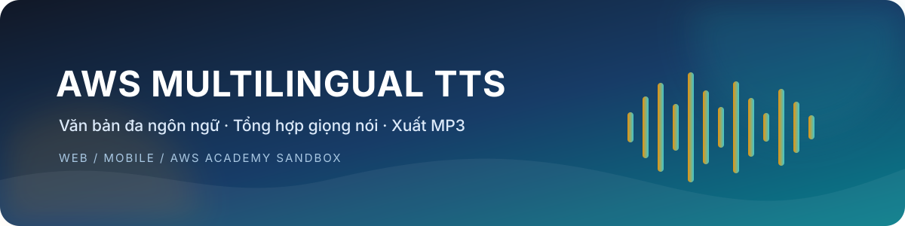
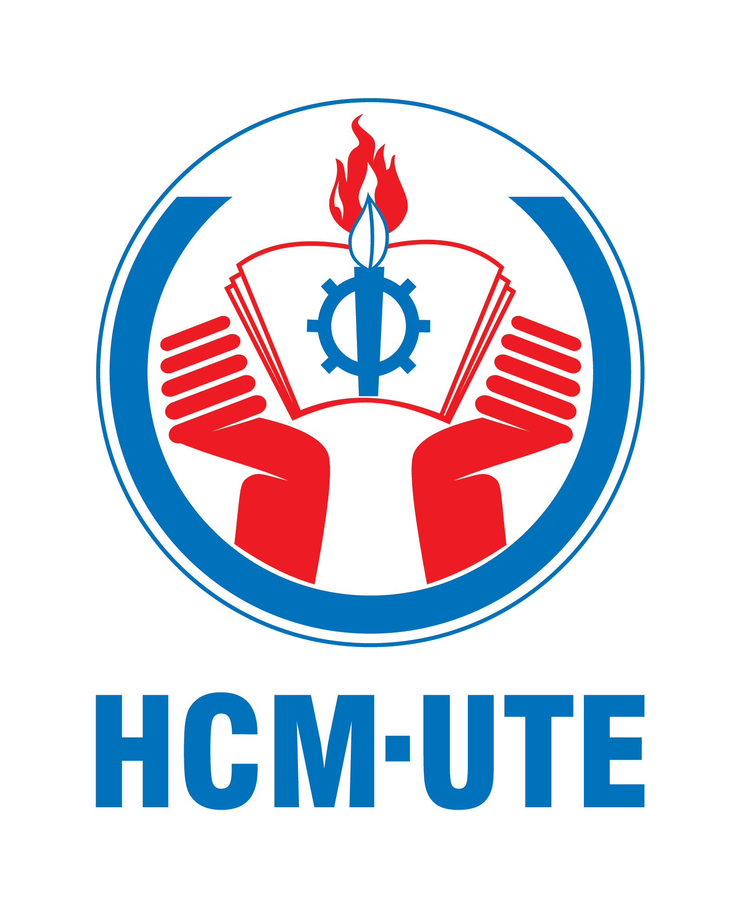
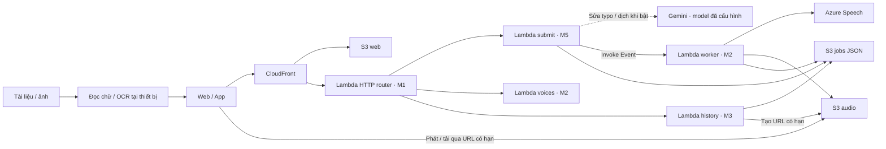

<div align="center">
  

  <p>
    
    &nbsp;&nbsp; | &nbsp;&nbsp;
    
  </p>

  <p>
    
    
    
    
  </p>
</div>

# AWS Multilingual TTS

Đồ án học phần **Điện toán đám mây**, xây dựng hệ thống chuyển văn bản thành giọng nói trên web và ứng dụng iOS/Android. Người dùng nhập văn bản hoặc đọc nội dung từ tài liệu, chọn ngôn ngữ và giọng đọc, tạo bản thu, phát trực tiếp, tải MP3 và quản lý lịch sử.

Repository được tổ chức theo trách nhiệm của năm thành viên. Frontend dùng React/Vite và Expo; bản triển khai Sandbox hiện dùng Lambda, S3, CloudFront và Azure Speech. Ngôn ngữ ưu tiên là tiếng Việt, tiếng Anh và tiếng Nhật, theo catalog của resource Speech được cấu hình.

**Lưu ý về yêu cầu học phần:** đề gốc yêu cầu API Gateway, Amazon Polly và DynamoDB. Bản Sandbox hiện dùng Function URL, Azure Speech và S3 JSON thay thế ba thành phần này. Phương án thay thế cần được giảng viên chấp thuận hoặc nhóm cần được cấp môi trường có quyền triển khai đúng đề; chưa coi việc demo Azure chạy được là đã đáp ứng đủ yêu cầu.

## Mục lục

- [Chức năng và trạng thái](#chức-năng-và-trạng-thái)
- [Kiến trúc](#kiến-trúc)
- [Công nghệ](#công-nghệ)
- [Cấu trúc repository](#cấu-trúc-repository)
- [Phân công và bàn giao](#phân-công-và-bàn-giao)
- [Chạy local](#chạy-local)
- [Hợp đồng API](#hợp-đồng-api)
- [Triển khai trên AWS Academy](#triển-khai-trên-aws-academy)
- [Kiểm thử](#kiểm-thử)
- [Cấu hình, dữ liệu và bảo mật](#cấu-hình-dữ-liệu-và-bảo-mật)
- [Làm việc nhóm](#làm-việc-nhóm)
- [Xử lý sự cố](#xử-lý-sự-cố)
- [Tài liệu và giấy phép](#tài-liệu-và-giấy-phép)

## Chức năng và trạng thái

| Chức năng | Hiện trạng |
|---|---|
| Chuyển văn bản thành MP3 | Có backend async và giao diện web/app. Một stack/web hiện có đã được chuyển sang Azure và ghi nhận demo ngày 08/11/2026. |
| Chọn ngôn ngữ, giọng và tốc độ | Lấy từ `/voices`; danh mục Azure được xác minh theo resource/vùng khi chạy `configure`. |
| Nhập tài liệu và OCR | Có trong Tạo giọng đọc và Dịch và đọc, mỗi trang giữ nội dung riêng. PDF, DOCX, TXT, Markdown và ảnh JPG/PNG/WebP; tối đa 50 MB, 200.000 ký tự và 50.000 từ. OCR tại thiết bị cho ảnh/PDF scan, đã thử local trên Chrome. |
| Tài liệu dài | Chia thành các bản thu tối đa 10.000 ký tự; chọn từng phần hoặc tạo tuần tự, dừng khi gặp lỗi/quota. Chưa kiểm chứng trên Sandbox/điện thoại thật. |
| Phát và tải âm thanh | MP3 dùng URL có hạn; player web lấy thời gian từ tệp, hỗ trợ tạm dừng, tua, lặp lại và điều chỉnh âm lượng. |
| Lịch sử bản thu | Có danh sách, phân trang, phát lại và xóa bản thu đã kết thúc. Dữ liệu hiện dùng chung cho scope demo. |
| Giao diện | Tiếng Việt, sáng/tối/theo hệ thống, giảm chuyển động và tăng tương phản; thiết kế kính trên web và app. |
| Nghe thử không có backend | Dùng giọng có sẵn trên thiết bị. Chế độ này không tạo tệp MP3 trên AWS. |
| Dịch và đọc | Có code Azure Translator → Azure Speech, chọn giọng đích, giữ bản gốc và hiển thị bản dịch. Cần resource/key Translator riêng và cấu hình theo hướng dẫn; chưa nghiệm thu live trong đợt này. |
| Sửa lỗi đánh máy bằng Gemini | M5 đã có code và test mock; mặc định tắt, chưa gọi Gemini thật hoặc deploy. |
| Thống kê đầy đủ | M5 đã có code quét job S3 có giới hạn; chưa xác minh trên bucket Sandbox thật. |

Code, kiểm thử local và demo trong một phiên là các mức bằng chứng khác nhau. Khả năng tạo mới toàn bộ stack, dựng lại sau reset và hoạt động trên thiết bị thật cần được kiểm riêng. Trạng thái và tiêu chí nghiệm thu của từng phần nằm trong README/CHANGELOG của thành viên.

## Kiến trúc

### Yêu cầu đề bài và phương án Sandbox

| Thành phần | Đề bài | Bản Sandbox hiện tại | Phụ trách |
|---|---|---|---|
| HTTP API | Amazon API Gateway | CloudFront → Lambda Function URL | M1, phối hợp M4 |
| Xử lý nghiệp vụ | AWS Lambda | Router, submit, worker, voices và history Lambda | M1, M2, M3, M5 |
| Tổng hợp giọng nói | Amazon Polly | Azure Speech | M2 |
| Lưu âm thanh | Amazon S3 | Bucket audio private | M3 |
| Lưu metadata | Amazon DynamoDB | JSON riêng cho từng job trong S3 | M3 |
| Phân phối web | Giao diện web | S3 web private và CloudFront | M4 |

Nhóm trưởng phối hợp giảng viên chốt môi trường hoặc chấp thuận thay thế. Việc hỗ trợ đúng Polly/DynamoDB/API Gateway cần triển khai và kiểm quyền riêng, không chỉ đổi tên trong sơ đồ. Xem [điều kiện nghiệm thu](AGENTS.md#3-yêu-cầu-đề-bài-và-trạng-thái-phải-diễn-đạt-đúng).

### Luồng được triển khai trong source



1. Frontend lấy catalog, người dùng chọn ngôn ngữ/giọng và gửi nội dung.
2. Router kiểm request, mã demo và chuyển tới submit. Submit tạo job `PENDING`, gọi worker bằng Lambda Event và trả HTTP `202`.
3. Worker nhận job, chuyển `PROCESSING`, đọc key từ SSM SecureString, gọi Azure, lưu MP3 vào S3 và cập nhật `DONE` hoặc `FAILED`.
4. Frontend polling `/jobs/{id}`. Khi hoàn tất, backend cấp URL đọc có hạn để phát hoặc tải; mở lại bản thu sẽ lấy URL mới.

Tài liệu dài được chia ở frontend thành nhiều request theo API này; mỗi phần có job và MP3 riêng. Tệp gốc không tải lên AWS để OCR. Bộ nhận dạng cần mạng để tải mã lõi/dữ liệu ngôn ngữ; người dùng kiểm tra và sửa chữ trước khi tạo giọng. PDF tối đa 200 trang, trong đó không quá 30 trang cần OCR/lần nhập. Chọn **Tạo các phần còn lại · bản gốc** để tạo lần lượt; phần đã thành công được bỏ qua trong phiên màn hình hiện tại. Tải lại trang/mở lại màn hình cần đối chiếu Lịch sử trước khi chạy cả tài liệu lần nữa.

Màn **Dịch và đọc** mặc định dùng Azure Translator → Azure Speech, giữ bản gốc và hiển thị bản dịch kèm MP3. Giao diện web và app chỉ dùng Azure; lựa chọn Gemini đã gỡ khỏi màn này ngày 10/11/2026. API `/text/translate` (Gemini) của M5 vẫn còn ở backend, mặc định tắt và không có giao diện gọi. TTS vẫn tối đa 10.000 ký tự/lượt.

S3 web, jobs và audio là ba bucket riêng. Metadata không lưu presigned URL. S3 conditional write/lease giúp kiểm soát cập nhật đồng thời, nhưng không tạo giao dịch nhiều object hoặc bảo đảm provider chỉ bị tính phí đúng một lần.

Chi tiết routing, quyền, timeout và recovery: [ARCHITECTURE.md](docs/ARCHITECTURE.md) và [CONVENTIONS.md](docs/CONVENTIONS.md).

## Công nghệ

| Phần | Công nghệ |
|---|---|
| Web | React 19, TypeScript, Vite 6, CSS, Glisse, Framework7 Icons |
| App | Expo SDK 58, React Native, Expo Router, Expo Audio/Speech, Glass Effect/Blur |
| Backend | Python 3.12, AWS SDK, Lambda handlers theo module |
| Dữ liệu | S3 jobs JSON, S3 audio private, Common Lambda Layer |
| Hạ tầng | AWS SAM/CloudFormation, CloudFront/OAC, SSM SecureString, CloudWatch/SNS theo template |
| TTS mặc định | Azure Speech; adapter ElevenLabs được giữ cho tương thích và kiểm thử cũ |
| Sửa typo và dịch theo ngữ cảnh | Gemini qua backend M5; model phải được key hỗ trợ, mặc định tắt; có thể cấu hình ở runtime local chung |
| Triển khai | Thủ công trong CloudShell/Lab IDE; review changeset trước khi áp dụng |

Phiên bản cài đặt được khóa tại `package-lock.json` của từng frontend. Giữ lockfile khi làm việc nhóm.

## Cấu trúc repository

```text
.
├── backend/
│   ├── m1-minh-ly/
│   │   ├── http/                       # Router và kiểm tra HTTP
│   │   ├── infra/                      # API/alarms và dashboard
│   │   ├── scripts/                    # Công cụ khảo sát M1
│   │   ├── reference/                  # Quyền Sandbox và EC2 lịch sử
│   │   ├── tests/
│   │   ├── README.md
│   │   └── CHANGELOG.md
│   ├── m2-trung-khang/
│   │   ├── synthesize/providers/       # Worker và provider adapters
│   │   ├── voices/                     # Catalog giọng đọc
│   │   ├── config/                     # Registry nguồn
│   │   ├── infra/
│   │   ├── tests/
│   │   ├── README.md
│   │   └── CHANGELOG.md
│   ├── m3-trung-duc/
│   │   ├── common/python/tts_common/   # Layer dùng chung
│   │   ├── history/                    # Job, lịch sử và xóa bản thu
│   │   ├── infra/
│   │   ├── tests/                      # Có fixture S3 dùng chung
│   │   ├── README.md
│   │   └── CHANGELOG.md
│   └── m5-trung-nghia/
│       ├── submit/                     # Validation và điều phối async
│       ├── stats/                      # Thống kê từ S3, quét có giới hạn
│       ├── infra/
│       ├── tests/
│       ├── README.md
│       └── CHANGELOG.md
├── frontend/                           # M4 — Nguyên Khang
│   ├── shared/                         # Giới hạn, chia phần, OCR và mã submit dùng chung
│   ├── web/                            # React/Vite: src, public, tests
│   ├── app/                            # Expo: src, assets, scripts, tests
│   ├── infra/hosting.yaml              # S3 web, CloudFront và OAC
│   ├── tts-readme-banner.svg
│   ├── README.md
│   └── CHANGELOG.md
├── deployment/
│   ├── config/settings.json            # Thông số chung không nhạy cảm
│   ├── scripts/azure.py                # Configure, plan, apply, status
│   ├── scripts/sandbox.sh              # Upload web và smoke HTTP
│   ├── template.yaml                   # Root SAM nối các stack con
│   └── samconfig.toml
├── docs/
│   ├── ARCHITECTURE.md
│   ├── CONVENTIONS.md
│   ├── AZURE-SPEECH.md
│   └── REPORT.md
├── .github/PULL_REQUEST_TEMPLATE.md
├── .gitignore
├── AGENTS.md
└── README.md
```

Nhiệm vụ nằm trong README của owner; lịch sử nằm trong CHANGELOG cùng thư mục. `src/app`, `(tabs)`, `python/tts_common` và các file cấu hình công cụ được giữ theo chuẩn đóng gói. Không tạo thêm bản sao task, release patch hoặc backend trong frontend.

## Phân công và bàn giao

| Module | Thành viên | Phạm vi | Hướng dẫn |
|---|---|---|---|
| M1 | Minh Lý | HTTP router, root SAM, quyền LabRole, URL/policy Lambda, CloudWatch/SNS | [README M1](backend/m1-minh-ly/README.md) |
| M2 | Trung Khang | Provider, worker, voices, MP3, cấu hình async worker | [README M2](backend/m2-trung-khang/README.md) |
| M3 | Trung Đức | Common Layer, S3 jobs/audio, schema/CAS, history, presign và retention | [README M3](backend/m3-trung-duc/README.md) |
| M4 | Nguyên Khang | Web/app, API client, player, CloudFront/OAC và upload web | [README M4](frontend/README.md) |
| M5 | Trung Nghĩa | Submit, validation, idempotency/recovery, telemetry và kiểm thử luồng | [README M5](backend/m5-trung-nghia/README.md) |

Thứ tự tích hợp: **M1 kiểm quyền và hợp đồng → M3 common/schema → M2 worker/voices và M5 submit → M1 HTTP/M4 giao diện → kiểm lỗi, recovery và reset**. M2 sở hữu một `EventInvokeConfig` của worker; M5 bàn giao policy retry. M1 sở hữu Lambda URL/policy, M4 sở hữu CloudFront/OAC association.

Các gate, đầu ra và điều kiện chuyển bước được quy định trong [AGENTS.md](AGENTS.md#4-kế-hoạch-triển-khai-và-điểm-bàn-giao).

## Chạy local

### Điều kiện

- Git và **Node.js 22 LTS, từ 22.13** cho cả web/app; app có `.nvmrc` chọn Node 22.
- **Python 3.12** để kiểm thử backend. Trên hệ thống dùng tên lệnh `python` thay `python3.12`, kiểm `python --version` trước khi thay lệnh.
- Expo Go tương thích **SDK 58** để demo trên điện thoại; thiết bị phải kết nối được Metro trên máy chạy app.
- Không cần AWS credentials hoặc Azure key để chạy giao diện local và các bộ kiểm thử mock.

### Backend Python local

Để thử tạo MP3/dịch trước khi deploy, dùng [hướng dẫn local](deployment/local/README.md). Sau khi cài dependency Python/web/app và điền key trong `deployment/local/.env.local`, chạy từ gốc repo:

```bash
npm run dev
```

Lệnh mở API Python, web tại `http://127.0.0.1:5173` và QR Expo Go. Tự nhận IP LAN cho điện thoại/các URL MP3, không sửa env hay đưa key vào frontend; **Ctrl+C dừng cả ba**. Điện thoại và máy cùng Wi-Fi, nhập `DEMO_TOKEN` tại Cài đặt web/app. Catalog thiếu/khác vùng được lấy từ Azure nếu đã có Speech key; `--no-voices` bỏ bước gọi catalog, `--refresh-voices` lấy lại. Không cần mở Sandbox hoặc AWS credentials.

Nếu chỉ muốn chạy backend riêng:

```bash
python3.12 -m venv .venv
.venv/bin/python -m pip install -r deployment/local/requirements.txt
.venv/bin/python deployment/local/server.py voices
.venv/bin/python deployment/local/server.py
```

`voices` gọi Azure thật sau khi bạn điền Speech key. Runtime không gọi AWS thật; job/MP3 lưu trong Moto RAM và mất khi tắt API. `.env.example` nằm cạnh từng cấu hình, file env thật được ignore. Không chạy thêm từng dịch vụ bên dưới khi đã dùng `npm run dev` ở gốc repo.

### Web

Từ gốc repository:

```bash
cd frontend/web
npm ci
npm run dev
```

Mặc định mở `http://127.0.0.1:5173`. Để nối Python local, `frontend/web/.env.local` dùng:

```dotenv
VITE_API_BASE_URL=/api
LOCAL_API_TARGET=http://127.0.0.1:8000
```

Nhập `DEMO_TOKEN` của env backend trong **Cài đặt → Kết nối** (mẫu local: `local-demo`), không đặt mã trong env frontend. Khi nối Sandbox sau này, đổi API base thành domain CloudFront hoạt động hoặc để script upload build đúng domain. Đổi env cần khởi động lại dev server.

Muốn thử Gemini của M5 bằng cùng lệnh chạy, xem [cấu hình Gemini tùy chọn](deployment/local/README.md#gemini-tùy-chọn-sau-khi-gộp-m5). Key/model chỉ ở env backend và phải được tài khoản hỗ trợ; Azure tiếp tục dùng key riêng. Không cần cấu hình Gemini để dùng dịch Azure.

### App iOS/Android

Mở terminal khác, từ gốc repository:

```bash
cd frontend/app
npm ci
npm start -- --clear
```

`npm ci` chạy `prepare` để tạo PDF bundle cần cho app; không dùng `--ignore-scripts`. iPhone quét QR bằng Camera, Android mở Expo Go để quét. Dùng Expo Go đúng SDK với project.

Local: tạo `frontend/app/.env.local` từ `.env.example` và dùng IP LAN theo [hướng dẫn](deployment/local/README.md#4-expo-go-trên-điện-thoại). Khi chuyển Sandbox, dùng:

```dotenv
EXPO_PUBLIC_API_BASE_URL=https://TEN-MIEN-CUA-NHOM.cloudfront.net
```

Khởi động lại Metro rồi nhập mã demo trong Cài đặt của app. Link CloudFront phải còn hoạt động; `localhost` trên điện thoại là chính điện thoại, không phải máy chạy backend.

### Hai chế độ sử dụng

| Chế độ | Cấu hình | Kết quả |
|---|---|---|
| UI mẫu | API base trống | Dữ liệu mẫu/cục bộ và giọng thiết bị; chưa có MP3. |
| Backend local | Web `/api` qua Vite; app IP LAN của máy | Handler thật, Azure thật khi bấm tạo giọng/dịch; lưu trữ AWS được Moto mô phỏng trong RAM. |
| Kết nối backend | Có API base và mã demo hợp lệ | Catalog/job/history từ API, MP3 từ backend và S3. |

Giọng đọc thiết bị phụ thuộc hệ điều hành và gói giọng đã cài. Khi backend báo lỗi, frontend hiển thị lỗi; không chuyển ngầm sang giọng local rồi coi là MP3 cloud thành công.

## Hợp đồng API

Các đường dẫn được giữ thống nhất giữa web, app và router. Request demo dùng `X-Demo-Token`; scope `demo` do backend gán, không nhận userId/bucket/ARN từ client.

| Method | Path | Chức năng | Owner |
|---|---|---|---|
| POST | `/synthesize` | Tạo job mới, trả `202`, xử lý bất đồng bộ | M5 |
| GET | `/voices` | Catalog giọng và cấu hình khả dụng | M2 |
| GET | `/jobs/{id}` | Polling trạng thái, URL có hạn khi `DONE` | M3 |
| GET | `/history` | Lịch sử với `limit`/`cursor` | M3 |
| DELETE | `/history/{id}` | Xóa bản thu đã kết thúc; job bận trả `409` | M3 |
| POST | `/text/correct` | Gemini đề xuất lỗi đánh máy khi bật, lỗi trả nguyên văn bản | M5 |
| POST | `/text/translate` | Dịch một đoạn theo ngữ cảnh khi bật; không tự tạo job TTS | M5 |
| GET | `/stats` | Thống kê job trong S3; vượt giới hạn trả 503 | M5 |

Trạng thái job: `PENDING → PROCESSING → DONE | FAILED`. Lỗi dùng cùng cấu trúc:

```json
{
  "error": {
    "code": "ERROR_CODE",
    "message": "Thông báo để người dùng xử lý"
  }
}
```

Mẫu request/response, replay, paging, schema dữ liệu và giới hạn chính thức của nhóm nằm trong [CONVENTIONS.md](docs/CONVENTIONS.md). Có endpoint trong router không đồng nghĩa tính năng mở rộng đã được bật.

## Triển khai trên AWS Academy

Quy trình này dành cho **phương án Azure hiện tại**, chạy thủ công trong CloudShell/Lab IDE của phiên Academy được giao. Không chạy các lệnh AWS từ laptop bằng credentials xuất từ lab. Đọc [AZURE-SPEECH.md](docs/AZURE-SPEECH.md) trước khi thực hiện, gồm tạo Speech F0, kiểm vùng Students, cấu hình key, dựng stack và xử lý lỗi.

AWS regional resources dùng `us-east-1`. Azure dùng đúng vùng Speech resource, ví dụ `eastasia`; hai giá trị này độc lập.

**Lệnh gọn để chuẩn bị demo** trên CloudShell, từ gốc repo đã có đầy đủ code mới:

```bash
bash deployment/scripts/demo.sh
```

Script dùng lại cấu hình Azure nếu đã có; lần đầu sẽ hỏi Azure Key 1. Nó tạo changeset, chờ bạn xem và gõ `APPLY`, cập nhật stack, upload web, đợi CloudFront và smoke HTTP, rồi in URL. Nếu Azure resource không ở `eastasia`, chạy `bash deployment/scripts/demo.sh --azure-region VUNG_AZURE`. Có thể thêm `--daily-char-limit N` khi nhóm đã chốt quota cho tài liệu dài. Ngày demo, nếu stack/web đã chuẩn bị, chỉ cần `bash deployment/scripts/demo.sh --check` để kiểm và lấy URL; chế độ này không deploy. Gemini key và cờ bật Gemini vẫn được cấu hình riêng; script không hỏi key Gemini. Các bước thủ công bên dưới giải thích từng thao tác khi cần xử lý lỗi.

### 1. Cấu hình provider và chuẩn bị thay đổi

Chạy tại gốc repo trong CloudShell:

```bash
python3 deployment/scripts/azure.py configure --region eastasia
python3 deployment/scripts/azure.py plan
```

`configure` nhận key kín, kiểm catalog và lưu SSM SecureString. `plan` đóng gói source và tạo changeset CREATE/UPDATE, **chưa thực thi stack**. Kiểm danh sách resource và điều kiện quyền trước bước tiếp theo.

### 2. Áp dụng changeset và đưa web lên

Sau khi review:

```bash
python3 deployment/scripts/azure.py apply
bash deployment/scripts/sandbox.sh web
```

Script upload lấy domain, distribution và bucket từ Stack Outputs, build web với API base tương ứng rồi đồng bộ S3/invalidate CloudFront. App native dùng domain API đó; không upload bundle app vào bucket web.

### 3. Kiểm tra bản triển khai

```bash
python3 deployment/scripts/azure.py status
bash deployment/scripts/sandbox.sh e2e-cf
```

`status` kiểm cấu hình Lambda; `e2e-cf` smoke HTTP, không thay kiểm thử tạo MP3. Chủ lab lấy mã demo riêng bằng `bash deployment/scripts/sandbox.sh ma` và nhập tại Cài đặt. Thử câu ngắn, đợi `DONE`, phát/tải MP3, mở lại lịch sử và xóa bản thu mẫu.

Sandbox đang dùng dọn tài nguyên và dữ liệu cuối phiên theo handout. Phiên sau cần kiểm thực trạng, dựng lại khi cần, lấy Outputs/token và bind lại web/app. Không tự xóa stack lỗi để thử lại; xem Events và hướng dẫn xử lý trước.

## Kiểm thử

Chạy từ gốc repository. Các suite bên dưới dùng mocks và không yêu cầu AWS/provider key.

### Backend

```bash
python3.12 -m unittest discover -s backend/m1-minh-ly/tests
python3.12 -m unittest discover -s backend/m2-trung-khang/tests
python3.12 -m unittest discover -s backend/m3-trung-duc/tests
python3.12 -m unittest discover -s backend/m5-trung-nghia/tests
```

Fixture S3 dùng chung nằm tại `backend/m3-trung-duc/tests/fake_s3.py`; mỗi suite vẫn đặt trong module sở hữu.

### Web và app

Sau khi đã chạy `npm ci` trong từng project:

```bash
npm --prefix frontend/web run build
npm --prefix frontend/web run test:ui
npm --prefix frontend/app run typecheck
npm --prefix frontend/app run lint
npm --prefix frontend/app test
```

Kiểm đóng gói native, chạy trong `frontend/app`:

```bash
npx expo export --platform ios --platform android
```

`build` và native export xác minh compile/asset/import, không thay kiểm tra safe area, bàn phím, âm thanh và thao tác trên iPhone/Android thật.

### Hạ tầng

Nếu đã cài `cfn-lint`, chạy local:

```bash
cfn-lint deployment/template.yaml backend/*/infra/*.yaml frontend/infra/*.yaml
```

Rà thêm `Location`, `CodeUri`, `ContentUri` sau khi di chuyển file. Giữ logical ID, tên resource, namespace `tts_common` và một cấu hình async cho worker khi thay đổi bố cục repo.

## Cấu hình, dữ liệu và bảo mật

- `deployment/config/settings.json` là thông số chung không nhạy cảm; cấu hình runtime thực nằm trong template/Parameters/Outputs và biến môi trường Lambda.
- Registry nguồn ở `backend/m2-trung-khang/config/`; bản trong `backend/m3-trung-duc/common/python/tts_common/` phục vụ đóng gói Layer. `configure` giữ hai bản Azure đồng bộ. Registry Azure trong Git ban đầu chưa có catalog thật.
- Giới hạn hiện tại: nhập tệp tối đa 50 MB, 200.000 ký tự và 50.000 từ; mỗi job tối đa 10.000 ký tự, tốc độ mặc định 0,9× trong dải 0,7–1,2×. Quota server mặc định 30.000 ký tự nguồn/ngày cho scope demo chung, độc lập với giới hạn nhập tệp. Khi được giao triển khai tài liệu dài, dùng `deployment/scripts/azure.py plan --daily-char-limit N` với hạn mức đã thống nhất, review changeset rồi mới apply; quota Azure tính riêng. Xem [hướng dẫn frontend](frontend/README.md#nhập-tài-liệu-scan-và-tạo-nhiều-bản-thu).
- Chỉ đưa API base công khai vào `VITE_*`/`EXPO_PUBLIC_*`. Key provider không nằm trong bundle, repository, log hoặc screenshot.
- Token demo nhập lúc chạy; web hiện lưu localStorage, app dùng AsyncStorage. Đây là cơ chế demo giới hạn, không phải hệ thống tài khoản tách dữ liệu theo người. Xóa mã trên thiết bị mượn sau sử dụng.
- Không commit AWS credentials, `.env*`, token, key, văn bản riêng tư hoặc presigned URL đầy đủ. Cache/dependency/build output được ignore; giấy phép, lockfile và tests phải được giữ.
- Lambda dùng `LabRole` hiện hữu. Không tự tạo IAM role/policy/OIDC hoặc thêm dịch vụ ngoài quyền lab. Tên dịch vụ trong allowlist chưa chứng minh action cụ thể được cấp.

## Làm việc nhóm

Trước khi sửa, đọc [AGENTS.md](AGENTS.md), kiến trúc, hợp đồng API và **toàn bộ README/CHANGELOG của module mình**. Kiểm working tree trước khi cập nhật nhánh:

```bash
git status --short --branch
git fetch origin
```

Các nhánh làm việc: `m1-minhly`, `m2-trungkhang`, `m3-trungduc`, `m4-nguyenkhang`, `m5-trungnghia`; `main` là nhánh tích hợp. Cập nhật nhánh bằng fast-forward khi có thể, hoặc merge có review để giữ công việc riêng. Không dùng force-push/reset để đồng bộ đè nhánh của thành viên.

Sau khi thay đổi:

1. Chạy kiểm tra tương ứng và suite của các module phụ thuộc nếu đổi hợp đồng/Layer.
2. Cập nhật README nhiệm vụ và CHANGELOG của owner; giữ bằng chứng cũ, chỉ tick task có kết quả thực.
3. Review diff, file sinh tự động và bí mật trước khi commit; dùng [PR template](.github/PULL_REQUEST_TEMPLATE.md) để ghi phạm vi và validation.
4. Khi đổi shared Layer, root SAM, API contract hoặc kiến trúc theo đề, phối hợp đúng owner và ghi quyết định trước triển khai.

Phân biệt `planned`, `coded`, `locally tested`, `sandbox verified` và `deployed & demoed`. Không dùng kết quả mock hoặc sơ đồ làm bằng chứng deploy.

## Xử lý sự cố

| Hiện tượng | Kiểm tra trước |
|---|---|
| Vite không resolve được package/icon | Đứng đúng `frontend/web`, chạy `npm ci` theo lockfile; xem lỗi import cụ thể, không tắt overlay để che lỗi. |
| Expo Go báo SDK không tương thích | Đối chiếu SDK 58 trong project với Expo Go; không thay `sdkVersion` thủ công để bỏ qua kiểm tra dependency. |
| App không kết nối Metro | Kiểm Node đúng phiên bản, mạng điện thoại/máy, QR và port Metro; chạy lại với `--clear`. |
| Web/app báo không kết nối máy chủ | Kiểm API base, lab còn hoạt động, domain mới sau reset và khởi động lại dev server sau đổi env. |
| HTTP 401 | Kiểm mã demo của đúng stack trong Cài đặt; nếu lỗi đến từ provider, khoanh vùng theo hướng dẫn Azure thay vì đổi token frontend. |
| `/voices` không có catalog | Chạy `configure` trong lab được giao; kiểm vùng Azure và hai registry nguồn/Layer. |
| MP3 không tải hoặc link hết hạn | Mở lại bản thu để lấy URL mới, kiểm job `DONE`, quyền S3/CORS và phiên lab. |
| CloudFormation bị từ chối hoặc rollback | Kiểm Events/action/principal/region theo [hướng dẫn Azure](docs/AZURE-SPEECH.md); không tự sửa IAM hoặc xóa tài nguyên nhóm. |

## Tài liệu và giấy phép

| Tài liệu | Nội dung |
|---|---|
| [AGENTS.md](AGENTS.md) | Phạm vi, gate triển khai, owner, nghiệm thu và quy tắc an toàn |
| [ARCHITECTURE.md](docs/ARCHITECTURE.md) | Luồng hệ thống, routing, capability và phương án triển khai |
| [CONVENTIONS.md](docs/CONVENTIONS.md) | Hợp đồng API, dữ liệu, auth, lỗi, retry và giới hạn |
| [AZURE-SPEECH.md](docs/AZURE-SPEECH.md) | Hướng dẫn Azure → AWS Sandbox → web/app cho cả nhóm |
| [REPORT.md](docs/REPORT.md) | Khung báo cáo và cách trình bày bằng chứng theo đề |
| [Quyền Sandbox](backend/m1-minh-ly/reference/SANDBOX-PERMISSIONS.md) | Ma trận quyền và mức kiểm chứng theo action |
| [Kiểm quyền Sandbox](backend/m1-minh-ly/reference/SANDBOX-VALIDATION.md) | Runbook kiểm tra khi được giao thao tác lab |

Giữ nguyên thông báo giấy phép và ghi công thư viện tại [web/public/licenses](frontend/web/public/licenses/), [font OFL](frontend/web/public/fonts/OFL.txt), [app/licenses](frontend/app/licenses/) và [app/LICENSE](frontend/app/LICENSE).

Dịch và đọc, OCR 50 MB, request 10.000 ký tự và nghiệm thu các ngôn ngữ còn lại: xem [hướng dẫn cấu hình/kiểm tra](docs/AZURE-SPEECH.md#dịch-và-đọc--azure-translator). Đây là code/local test, không tự xác nhận Sandbox hay thay thế các dịch vụ bắt buộc của đề.
