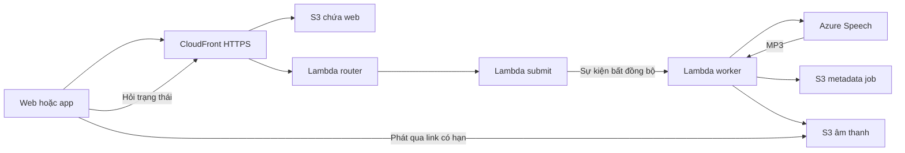

# Hướng dẫn cả nhóm: Azure Speech → AWS Sandbox → Web và App

Cập nhật **08/11/2026**. Dành cho cả năm thành viên, có thể làm từ đầu bằng tài khoản trường cấp. Các lệnh AWS trong tài liệu chạy **thủ công trong AWS CloudShell của phiên Academy đang hoạt động**.

**Kết quả cần đạt:** mở web/app, chọn tiếng Việt/Anh/Nhật, nhập nội dung, tạo bản thu, nghe và tải MP3. Azure tạo giọng nói; AWS chạy backend, lưu dữ liệu và phân phối web.

**Bằng chứng hiện có:** ngày 08/11, Nguyên Khang đã chạy configure, plan, apply, upload web thành công và báo dùng được trên web. Đây là kết quả một phiên Sandbox; tài khoản/phiên mới cần kiểm tra lại. Chưa coi toàn bộ giọng, luồng lỗi và app trên mọi thiết bị là đã nghiệm thu.

**Bản code cần dùng:** bản đồng bộ lên main và các nhánh thành viên có Azure mặc định. Luồng cập nhật stack Azure đã được Nguyên Khang thử trên web; luồng tạo stack mới bằng changeset trong bản này được kiểm thử local, cần xác nhận lại ở từng Sandbox. Lấy đúng code theo [mục 5](#code); không cần patch trong release.

## Mục lục

1. [Dùng chung hay tự dựng](#nhom)
2. [Thành phần và các loại mã](#tong-quan)
3. [Tạo Azure Speech Free F0](#azure)
4. [Mở AWS Academy và CloudShell](#aws)
5. [Lấy đúng code có Azure](#code)
6. [Kiểm tra stack trước khi cấu hình](#stack)
7. [Lưu key và lấy danh sách giọng](#configure)
8. [Thử riêng Azure khi cần khoanh vùng lỗi](#thu-azure)
9. [Review và áp dụng Azure vào backend](#cap-nhat)
10. [Đưa web lên CloudFront](#hosting)
11. [Sử dụng và kiểm thử web](#web)
12. [Nối app Expo Go và web local](#local)
13. [Cập nhật, đổi key và bàn giao](#bao-tri)
14. [Kết thúc lab và dựng lại phiên sau](#reset)
15. [Tra lỗi thường gặp](#loi)
16. [Bảng lệnh và checklist demo](#checklist)
17. [Nguồn và file liên quan](#nguon)

<a id="nhom"></a>

## 1. Dùng chung hay tự dựng

| Trường hợp | Cần làm |
|---|---|
| Một người dựng, cả nhóm cùng demo | Người triển khai làm phần Azure/AWS. Những người khác nhận link CloudFront và mã demo qua kênh riêng, làm mục 11; chạy app thì thêm mục 12. |
| Mỗi người thực hành trên Academy riêng | Mỗi người mở Sandbox của mình, lấy code có Azure và dựng hệ thống riêng theo mục 3–11. |
| Đã có stack `tts-dev` đang chạy | Kiểm trạng thái mục 6, làm configure → plan → apply; script giữ mã demo/CORS hiện có. |
| Lab vừa reset | Xác minh tài nguyên thực tế rồi làm mục 14. |

Năm tài khoản Academy không mặc nhiên dùng chung Lambda, S3 hay lịch sử. Khi mọi người mở **cùng link và mã demo**, mọi người dùng chung dữ liệu của bản triển khai đó. Một người xóa bản thu có thể làm nó biến mất với những người cùng dùng bản demo.

Không cần năm resource Azure nếu chỉ dùng một demo chung. Chủ resource giữ key và cấu hình; người dùng giao diện chỉ cần link/mã demo. Không chia sẻ mật khẩu Azure/AWS hoặc AWS credentials. Nếu cần deploy riêng với resource Azure chung, chủ key thực hiện cấu hình trong môi trường được giao và cả nhóm theo dõi quota chung.

Các script khảo sát riêng của M1 ở scripts/m1/ thuộc Lab 1/3, không dùng thay quy trình Sandbox/Azure này.

Người được nhóm giao triển khai thực hiện các bước tạo/cập nhật tài nguyên. M1 phụ trách hạ tầng/router, M2 provider/worker, M3 dữ liệu, M4 web/app/hosting, M5 submit/điều phối. Cùng một AWS account chỉ để một người cập nhật stack tại một thời điểm.

<a id="tong-quan"></a>

## 2. Thành phần và các loại mã



Worker đọc key từ SSM SecureString rồi gọi Azure. Backend tạo job, trả `202`, xử lý bất đồng bộ; giao diện hỏi trạng thái tới `DONE` hoặc `FAILED`. API và dữ liệu của nhóm vẫn nằm trên AWS. Bản này không dùng Polly, DynamoDB hoặc API Gateway.

| Thông tin | Lấy ở đâu | Dùng ở đâu |
|---|---|---|
| Azure Key 1 | Speech → Keys and Endpoint | Nhập kín vào `azure.py configure`; không nhập trên web/app. |
| Azure region | Resource Azure, ví dụ East Asia → `eastasia` | `--region` của configure. |
| AWS region | Academy Console → N. Virginia | Luôn `us-east-1` trong quy trình này. |
| Mã demo | Chủ lab chạy `bash scripts/sandbox.sh ma` | Nhập Cài đặt của web/app. |
| Link CloudFront | Lệnh `sandbox.sh web` hoặc Output `WebDomain` | Mở web, làm API base của app/web local. |
| Link MP3 có hạn | Backend trả theo bản thu | Phát/tải; không lưu nguyên link trong tài liệu/log. |

Azure `eastasia` và AWS `us-east-1` là hai vùng của hai nhà cung cấp khác nhau, dùng được cùng nhau trong cấu hình này.

**Giới hạn ứng dụng hiện tại:** 2.000 ký tự/yêu cầu, tốc độ mặc định 0,9×, dải 0,7–1,2×; mặc định 6.000 ký tự/ngày cho scope demo dùng chung. Quota Azure tính riêng. Dịch tự động, Gemini sửa lỗi đánh máy và thống kê đầy đủ chưa được bật bởi việc chuyển Azure.

<a id="azure"></a>

## 3. Tạo Azure Speech Free F0

### 3.1. Kiểm tài khoản sinh viên

Mở [Azure Portal](https://portal.azure.com/), đăng nhập tài khoản đã kích hoạt Azure for Students. Tìm **Subscriptions**, kiểm có **Azure for Students** với trạng thái **Enabled**. Đăng nhập được portal chưa chứng minh subscription đã hoạt động.

Nếu ô Subscription báo `No available items`:

1. Mở Subscriptions xem gói Students thực sự xuất hiện chưa.
2. Vào **Settings → Directories + subscriptions**, kiểm directory và bộ lọc subscription.
3. Nếu có nhiều directory, chọn directory chứa gói Students; không tự chuyển directory của subscription.
4. Tải lại portal, hoặc mở cửa sổ riêng tư và đăng nhập lại đúng account.
5. Khi thấy subscription, vào **subscription → Resources → Create** để tạo Speech trong đúng ngữ cảnh.

Xem điều kiện gói ở [Azure for Students](https://azure.microsoft.com/en-us/pricing/offers/ms-azr-0170p). Quy trình dưới đây dùng F0, không yêu cầu nâng gói trả phí.

### 3.2. Chọn vùng được phép

Tài khoản Students có thể bị chặn vùng dù dịch vụ có cung cấp tại đó. Gặp `RequestDisallowedByAzure`: mở **Policy → Authoring → Assignments**, chọn scope subscription, tìm **Allowed resource deployment regions** hoặc policy nêu trong lỗi. Xem **Parameters / Allowed locations**. [Hướng dẫn Microsoft về policy vùng của Students](https://learn.microsoft.com/en-us/questions/5931953/azure-for-students-subscription-policy-error-reque).

Trong phiên của Nguyên Khang, các vùng được cấp là `eastasia`, `koreacentral`, `indiasouthcentral`, `centralindia`, `indonesiacentral`; đã dùng thành công `eastasia`. Danh sách của thành viên khác có thể khác. Chọn vùng vừa được subscription cho phép vừa hỗ trợ Speech/F0.

### 3.3. Tạo resource

**Create a resource → tìm Speech → chọn Speech của Microsoft → Create**. Không chọn SaaS của bên thứ ba trong Marketplace.

| Trường | Giá trị mẫu |
|---|---|
| Subscription | Azure for Students |
| Resource group | Create new → `tts-demo-rg`, hoặc group của mình |
| Region | East Asia nếu được cấp; mã script: `eastasia` |
| Name | Tên riêng, ví dụ `hcmute-tts-tenban`; đổi nếu portal báo trùng |
| Pricing tier | **Free F0** |

Giữ Identity/Tags mặc định nếu không có yêu cầu khác. Mẫu này dùng endpoint công khai có xác thực key; cấu hình chỉ cho mạng riêng sẽ chưa phục vụ CloudShell/Lambda hiện tại. Không cần tạo private endpoint/VNet. Xem [tùy chọn mạng của Speech](https://learn.microsoft.com/en-us/azure/ai-services/speech-service/speech-services-private-link).

Chọn **Review + create**, kiểm lại **Free F0**, rồi **Create**. Khi thành công chọn **Go to resource**. Nếu portal tự đăng ký `Microsoft.CognitiveServices`, chờ hoàn tất; lỗi đăng ký/quyền xử lý theo subscription.

Nếu F0 không xuất hiện, kiểm đúng Speech của Microsoft, vùng và resource F0 đã có; chưa chọn S0 để vượt qua bước này. Các trường group/resource/SKU cũng có trong [ví dụ Speech của Microsoft](https://github.com/microsoft/IoT-For-Beginners/blob/main/6-consumer/lessons/1-speech-recognition/README.md).

### 3.4. Lấy key và ghi vùng

Resource → **Resource Management → Keys and Endpoint**. Chuẩn bị **Key 1** và **Location/Region**; tên resource không thay cho region. [Quickstart Microsoft](https://learn.microsoft.com/en-us/azure/ai-services/speech-service/get-started-text-to-speech) hướng dẫn lấy key/vùng trước khi gọi TTS.

Chỉ dán key vào prompt kín. Không lưu key trong ảnh, README, Git, chat, `.env` frontend hoặc nội dung lệnh. Nếu lộ, chủ resource đổi key và cấu hình lại; xóa ảnh/message không làm key cũ hết hiệu lực.

F0 hiện công bố **500.000 ký tự Neural TTS miễn phí/tháng**; kiểm [bảng giá Speech](https://azure.microsoft.com/en-us/pricing/details/speech/) trước khi demo. Đây không phải miễn phí vô hạn cho mọi tài nguyên AWS/Azure. Realtime F0 hiện giới hạn **20 giao dịch/60 giây**; cả nhóm dùng chung resource sẽ chia sẻ giới hạn. [Quota Speech](https://learn.microsoft.com/en-us/azure/ai-services/speech-service/speech-services-quotas-and-limits).

<a id="aws"></a>

## 4. Mở AWS Academy và CloudShell

1. Đăng nhập AWS Academy bằng tài khoản trường cấp.
2. Mở khóa **AWS Academy Cloud Foundations → Sandbox**.
3. Đọc README về region/dịch vụ/thời gian phiên.
4. Bấm **Start Lab**, đợi sẵn sàng rồi bấm **AWS** mở Console.
5. Chọn **United States (N. Virginia)**, tức `us-east-1`.
6. Mở **CloudShell** qua biểu tượng `>_`, đợi terminal sẵn sàng.

Các lệnh AWS bên dưới chạy trong CloudShell Bash. Không cần `aws configure`, không sao chép access key/session token ra laptop. Thao tác Azure Portal làm trên trang Azure, không phải trên AWS Console.

Kiểm công cụ/tài khoản:

```bash
export AWS_DEFAULT_REGION=us-east-1 AWS_PAGER=""
aws sts get-caller-identity --query Account --output text
aws iam get-role --role-name LabRole --query Role.RoleName --output text
aws --version
python3 --version
python3 -c "import boto3; print('Boto3', boto3.__version__)"
git --version
node --version
npm --version
```

Account phải thuộc phiên lab đang thao tác. Nếu token hết hạn, kiểm phiên Academy và mở lại Console/CloudShell trước khi deploy. Không đăng kết quả chứa thông tin account lên báo cáo công khai.

CloudShell có sẵn CLI, Python/Boto3, Git, Node/npm; phiên bản có thể đổi nên kiểm thực tế. [Phần mềm CloudShell](https://docs.aws.amazon.com/cloudshell/latest/userguide/vm-specs.html).

Web cần Node ≥20.19; app cần Node 22.13+ hoặc 24.3+ theo package.json. Nên dùng Node 22 đáp ứng cả hai. Nếu Node CloudShell quá cũ và đã có nvm, chạy `nvm install 22` rồi `nvm use 22`; nếu chưa có, chuẩn bị theo [hướng dẫn Node chính thức](https://nodejs.org/en/download) trước bước build. Không bỏ qua lỗi engine hoặc tự nâng dependency để chữa runtime.

<a id="code"></a>

## 5. Lấy đúng code có Azure

### 5.1. Clone lần đầu

```bash
cd ~
git clone https://github.com/solvarhuynh/aws-multilingual-tts.git aws-tts-demo
cd ~/aws-tts-demo
git status --short
git rev-parse --short HEAD
```

Nếu thư mục đã có, vào đó xem `git status --short` trước. Không clone chồng, reset hard hoặc xóa thay đổi người khác. Khi checkout sạch và nhánh được bàn giao đã có Azure, dùng `git pull --ff-only`; nếu nhóm dùng nhánh khác, chuyển đúng nhánh đã thống nhất rồi pull.

### 5.2. Kiểm trước khi tiếp tục

```bash
test -f scripts/azure.py && test -f backend/synthesize/providers/azure.py && test -f config/voices.azure.json && echo "PASS có các file Azure"
python3 scripts/azure.py --help
git diff --check
```

Help phải có configure/plan/apply/status. Root template có `TtsProvider` mặc định azure và ghép Storage/TtsCore/Submit/Api/Hosting. Nếu chỉ có ProjectMarker hoặc chưa có scripts/azure.py, đang dùng code cũ; chưa deploy.

Bản mới dùng một quy trình cho tạo mới và cập nhật: **configure → plan → review → apply → web**. Không cần tài khoản/key ElevenLabs hoặc áp dụng patch thủ công. Adapter ElevenLabs còn để tương thích dữ liệu/kiểm thử cũ, không được chọn mặc định khi deploy.

<a id="stack"></a>

## 6. Kiểm tra stack trước khi cấu hình

Trong đúng AWS account và us-east-1:

```bash
aws cloudformation describe-stacks --stack-name tts-dev --region us-east-1 --query 'Stacks[0].StackStatus' --output text
```

| Kết quả | Xử lý |
|---|---|
| Stack tts-dev không tồn tại | Làm mục 7 rồi 9. Plan sẽ tạo changeset CREATE, chưa execute. |
| CREATE_COMPLETE, UPDATE_COMPLETE, UPDATE_ROLLBACK_COMPLETE | Làm mục 7 rồi 9. Plan sẽ tạo UPDATE và giữ token/CORS. |
| Đang CREATE/UPDATE/ROLLBACK | Đợi và xem Events; chưa tạo cập nhật khác. |
| REVIEW_IN_PROGRESS | Có changeset CREATE chưa áp dụng; xem changeset đã review, không tạo plan khác chồng lên. |
| ROLLBACK_COMPLETE, UPDATE_ROLLBACK_FAILED hoặc lỗi khác | Nhờ M1 xem Events; script không tự xóa/tạo lại stack. |
| AccessDenied, token hết hạn hoặc lỗi mạng | Sửa quyền/phiên/kết nối; không coi là stack chưa tồn tại. |

Plan/apply tạo tài nguyên thật, chỉ làm trên lab được giao. Review root và năm template con với owner. Lambda dùng LabRole hiện có; không tạo IAM role/policy/OIDC hoặc dịch vụ ngoài baseline.

Không cần bước dựng nền ElevenLabs. Configure có thể lưu key trước khi stack tồn tại; plan sẽ chuẩn bị bucket artifact và mã demo khi tạo lần đầu.

<a id="configure"></a>

## 7. Lưu key và lấy danh sách giọng

Chạy trực tiếp trong terminal CloudShell. Ví dụ resource East Asia:

```bash
cd ~/aws-tts-demo
python3 scripts/azure.py configure --region eastasia
```

Thấy `Dán Key 1 Azure (không hiện), rồi Enter:` thì dán key và Enter. Terminal không hiện ký tự là bình thường. Resource ở vùng khác thì thay `eastasia` bằng mã vùng thực tế; AWS vẫn us-east-1.

Script làm tuần tự:

1. Lấy catalog Azure của key/vùng vừa nhập.
2. Lọc GA Neural, lấy tối đa một giọng nữ/nam mỗi ngôn ngữ mục tiêu; yêu cầu có Việt/Anh/Nhật.
3. Lưu key vào SSM SecureString **`/tts/dev/azure-speech`** qua Boto3 trong memory.
4. Sinh hai registry giống nhau: `config/voices.azure.json` và `backend/common/python/tts_common/voices.azure.json`.
5. Ghi `~/.tts-azure.json` chứa metadata, không có key.

Kết quả cần thấy:

```text
PASS cấu hình Azure: ... ngôn ngữ; key lưu riêng trong SSM.
```

Không yêu cầu luôn đúng 33 ngôn ngữ; số lượng phụ thuộc catalog. Hai registry có tên/ID giọng, không có key. Configure xác minh catalog, **chưa deploy Lambda hay tạo MP3**.

Bản mới có alias `bash scripts/sandbox.sh nhap-key eastasia` gọi đúng configure Azure. Ưu tiên lệnh python3 ở trên; nếu dùng script cũ từ phiên trước phải cập nhật code trước khi nhập key. Gặp AWS ParamValidation dạng ngắn xem mục 15.

<a id="thu-azure"></a>

## 8. Thử riêng Azure khi cần khoanh vùng lỗi

Bỏ qua nếu đã nghe được MP3 bằng chính resource/key/vùng này. Phép thử gọi Azure thật, tiêu thụ quota; chỉ chạy khi được giao kiểm thử. Chưa đi qua Lambda, S3 hoặc auth web.

Tạo file thử **ở home CloudShell, ngoài repo**. File chỉ có code/câu mẫu, không có key:

```bash
cat > ~/tts-azure-probe.py <<'PY'
import getpass
import re
import sys
import urllib.error
import urllib.request
from pathlib import Path

class NoRedirect(urllib.request.HTTPRedirectHandler):
    def redirect_request(self, *args, **kwargs):
        return None

def main():
    region = input('Region Azure [eastasia]: ').strip() or 'eastasia'
    if not re.fullmatch(r'[a-z][a-z0-9]{1,39}', region):
        raise ValueError('Mã vùng chưa hợp lệ')
    key = getpass.getpass('Key 1 Azure (ẩn): ').strip()
    if not key:
        raise ValueError('Chưa nhập key')
    ssml = ('<speak version="1.0" xmlns="http://www.w3.org/2001/10/synthesis" '
            'xml:lang="vi-VN"><voice name="vi-VN-HoaiMyNeural">'
            'Xin chào, đây là bản thử nghiệm của nhóm năm.</voice></speak>')
    request = urllib.request.Request(
        f'https://{region}.tts.speech.microsoft.com/cognitiveservices/v1',
        data=ssml.encode('utf-8'),
        headers={'Ocp-Apim-Subscription-Key': key,
                 'Content-Type': 'application/ssml+xml',
                 'X-Microsoft-OutputFormat': 'audio-24khz-96kbitrate-mono-mp3',
                 'User-Agent': 'hcmute-tts-demo'}, method='POST')
    with urllib.request.build_opener(NoRedirect).open(request, timeout=30) as response:
        audio = response.read(2_000_001)
    key = ''
    frame = len(audio) > 1 and audio[0] == 0xff and audio[1] & 0xe0 == 0xe0
    if len(audio) > 2_000_000 or not (audio.startswith(b'ID3') or frame):
        raise ValueError('Phản hồi chưa phải MP3 hợp lệ cho câu thử')
    output = Path.home() / 'azure-demo.mp3'
    output.write_bytes(audio)
    print(f'PASS MP3: {output}, {len(audio)} byte')

try:
    main()
except urllib.error.HTTPError as error:
    print(f'FAIL Azure HTTP {error.code}; kiểm tra key, vùng, network và quota.', file=sys.stderr)
    sys.exit(1)
except urllib.error.URLError:
    print('FAIL kết nối Azure; kiểm tra mạng và endpoint.', file=sys.stderr)
    sys.exit(1)
except Exception as error:
    message = str(error) if isinstance(error, ValueError) else type(error).__name__
    print('FAIL:', message, file=sys.stderr)
    sys.exit(1)
PY
python3 ~/tts-azure-probe.py
```

Nhập vùng rồi dán key ở prompt kín. Để nghe: **Actions → Download file**, nhập đường dẫn MP3 script vừa in, tải về và mở trên máy. Nếu vùng chưa có Hoài My, kiểm catalog ở mục 7 trước khi chọn giọng thử phù hợp. Request/output MP3 theo [REST Text to Speech](https://learn.microsoft.com/en-us/azure/ai-services/speech-service/rest-text-to-speech). Không bật curl verbose/AWS debug hoặc in request/header để tìm key.

<a id="cap-nhat"></a>

## 9. Review và áp dụng Azure vào backend

### 9.1. Tạo changeset

Đợi các job đang chạy kết thúc. Trong đúng checkout đã configure:

```bash
cd ~/aws-tts-demo
python3 scripts/azure.py plan
```

Lệnh chuẩn bị bucket artifact khi thiếu, upload code và tạo changeset; **chưa execute stack**. Stack chưa có dùng CREATE, stack sẵn sàng dùng UPDATE. Khi CREATE, mã demo sinh ở ~/.tts-demo-token với quyền file 0600 và truyền qua SDK, không in ra. Khi UPDATE, token/CORS giữ bằng UsePreviousValue. Giá trị dự kiến:

| Parameter | Giá trị |
|---|---|
| TtsProvider | `azure` |
| AzureSpeechRegion | Vùng vừa configure, ví dụ `eastasia` |
| TtsApiParameterName | `/tts/dev/azure-speech` |
| DemoToken/AllowedOrigin/Env | UPDATE giữ bằng UsePreviousValue; CREATE sinh token riêng và dùng mặc định đã review. |

Nếu tạo mới, thường thấy Add cho các stack con. Nếu cập nhật, ví dụ rút gọn bên dưới; danh sách thực tế có thể khác:

```text
Modify Storage AWS::CloudFormation::Stack replacement=False
Modify Submit AWS::CloudFormation::Stack replacement=False
Modify TtsCore AWS::CloudFormation::Stack replacement=False
PASS tạo changeset. Chưa thực thi. ...
```

Nếu plan báo không có thay đổi thì không cần apply; key mới chỉ cần đợi cache như mục 13. Nếu có changeset, vào **CloudFormation → tts-dev → Change sets → azure-switch-...**, review Parameters/Changes. Stack con có thể hiện Modify do được package lại. Kiểm cập nhật registry/Layer, code và biến provider/vùng của worker, voices, submit. Xem chi tiết thay đổi con nếu có; replacement=False của stack cha không đảm bảo mọi resource bên trong giữ nguyên.

Tạo mới/cập nhật đều phải review; script không tự xóa stack lỗi. Script chặn Remove/replacement=True ở danh sách root, không thay thế review nested stacks. Nếu có xóa/thay bucket, tạo IAM hoặc dịch vụ ngoài phạm vi, dừng gửi owner xem lại. Không đổi code/registry giữa plan và apply; đã đổi thì tạo plan mới.

### 9.2. Áp dụng changeset đã review

```bash
python3 scripts/azure.py apply
```

Đợi hoàn tất, kiểm kết quả. Tạo mới chờ stack-create-complete; cập nhật chờ stack-update-complete. CloudFront có thể lâu hơn Lambda, xem Events trước khi kết luận bị treo:

```text
PASS cập nhật stack. ...
tts-synthesize-dev Active Successful azure eastasia
tts-voices-dev Active Successful azure eastasia
tts-submit-dev Active Successful azure eastasia
PASS ba Lambda dùng cùng provider và vùng. Còn cần thử tạo MP3 trên web.
```

Vùng phải khớp resource của mình. Nếu đã execute nhưng terminal mất kết nối, xem Events/trạng thái stack trước, không apply lại ngay. Có thể đọc lại cấu hình:

```bash
python3 scripts/azure.py status
```

Status chỉ xác nhận cấu hình Lambda, chưa chứng minh gọi Azure, ghi S3 và phát âm thanh thành công.

<a id="hosting"></a>

## 10. Đưa web lên CloudFront

Sau khi apply thành công:

```bash
cd ~/aws-tts-demo
bash scripts/sandbox.sh web
```

Lệnh chạy npm ci, build với API base là domain CloudFront của chính stack, đồng bộ dist lên bucket web và tạo invalidation. Script dùng `s3 sync --delete` cho hosting; không áp dụng cho bucket jobs/audio.

Kết quả dự kiến:

```text
PASS web da len: https://...cloudfront.net
Lay ma truy cap bang: bash scripts/sandbox.sh ma
```

Mở link vừa in. Invalidation được tạo chưa có nghĩa cache hết ngay; nếu thấy bản cũ, đợi invalidation Completed rồi hard reload/mở cửa sổ riêng tư. Không lấy URL phiên cũ làm mặc định.

Lấy lại domain hiện tại mà không build:

```bash
aws cloudformation describe-stacks --stack-name tts-dev --region us-east-1 --query 'Stacks[0].Outputs[?OutputKey==`WebDomain`].OutputValue' --output text
```

Output chỉ là domain, thêm `https://` khi mở hoặc cấu hình API. Dùng CloudFront làm lối vào web/API; không tùy ý thay bằng Function URL của Lambda.

<a id="web"></a>

## 11. Sử dụng và kiểm thử web

### 11.1. Nhập mã truy cập

Chủ lab chạy:

```bash
bash scripts/sandbox.sh ma
```

Lệnh **cố ý hiển thị mã bí mật** trong CloudShell của chủ lab. Không chụp đầu ra hoặc dán mã vào Git/tài liệu/chat công khai. Bàn giao qua kênh riêng của nhóm.

Trên web: **Cài đặt → Kết nối máy chủ → Mã truy cập → Lưu mã**. Trang tải lại, lấy danh sách giọng từ máy chủ. Nhập mã demo vừa lấy, không nhập Azure Key 1 hay AWS credential.

Code web hiện lưu mã demo trong bộ nhớ lưu trữ trình duyệt; app giữ trong preferences thiết bị. Đây là cơ chế demo hiện có, chưa phải đăng nhập nhiều tài khoản hay lưu token bằng kho bí mật native. Trên máy mượn, xóa mã sau demo và kiểm nó không còn được điền. Scope lịch sử dùng chung nên chỉ dùng nội dung mẫu không nhạy cảm.

### 11.2. Thử một bản thu ngắn trước

1. Vào **Tạo giọng đọc**, chọn **Tiếng Việt → Hoài My** nếu có trong catalog.
2. Nhập: `Xin chào, đây là bản thử nghiệm chuyển văn bản thành giọng nói của nhóm năm.`
3. Giữ tốc độ mặc định, bấm tạo một lần và đợi.
4. Hoàn tất thì thử phát, tạm dừng và tải MP3.
5. Mở **Bản thu/Thư viện âm thanh**, kiểm bản vừa tạo xuất hiện.
6. Chỉ xóa sau khi hoàn tất; tải MP3 cần giữ trước khi xóa.

Nếu còn Brian/Matilda của ElevenLabs, kiểm status, URL, cache và đúng checkout đã deploy. Có âm thanh từ speech trên thiết bị nhưng không có MP3/lịch sử máy chủ chưa đủ nghiệm thu AWS.

### 11.3. Checklist cả nhóm cùng kiểm

| Phép thử | Kết quả cần thấy |
|---|---|
| Tiếng Việt | Chọn giọng Azure, tạo/phát/tải được MP3. |
| Tiếng Anh | Chọn English/giọng trong danh sách, thử `Hello, this is our text to speech demo.` |
| Tiếng Nhật | Chọn Japanese/giọng trong danh sách, thử `こんにちは。音声合成のテストです。` |
| Nội dung trống | UI từ chối, không sinh bản thu thừa. |
| Bấm tạo liên tiếp | Khóa thao tác lúc gửi, không sinh job trùng ngoài dự kiến. |
| Tạo rồi mở lịch sử | Đúng bản thu/ngôn ngữ/giọng/trạng thái và phát được. |
| Xóa bản đã xong | Bản thu biến mất, trình phát đang mở bản đó được dọn. |
| Tải lại web | Lấy lại lịch sử khi máy chủ/lab còn hoạt động. |
| Sai/thiếu mã demo | API chặn; thử trong cửa sổ riêng để giữ phiên chính. |
| Sáng/tối, màn hình hẹp | Chữ/nút/trình phát đọc được, không che vùng thao tác. |

Mỗi câu thử dùng quota. Chạy tuần tự, tránh năm người gửi đồng loạt. Azure TTS không tự dịch tiếng Việt sang tiếng Anh; chọn ngôn ngữ khớp nội dung.

Kiểm đường HTTP CloudFront bằng script sẵn có, không tạo MP3:

```bash
bash scripts/sandbox.sh e2e-cf
```

Đọc từng PASS/FAIL; bản mới trả exit code thất bại khi có kiểm tra lỗi, không ghi file chứa token/response. /text/correct có thể trả skipped khi chưa bật Gemini. Lệnh e2e cũ đã bỏ; kiểm thử MP3/history/delete theo checklist ở trên, không ép catalog đúng 33 ngôn ngữ.

<a id="local"></a>

## 12. Nối app Expo Go và web local

Các bước mục này chạy **trên máy cá nhân**, chỉ dùng URL công khai/mã demo. AWS credentials vẫn ở CloudShell. Máy cá nhân cần code đã bàn giao và Node/npm phù hợp.

### 12.1. App iOS/Android bằng Expo Go

Tạo `frontend/app/.env.local`, thay domain mẫu bằng domain stack hiện tại:

```dotenv
EXPO_PUBLIC_API_BASE_URL=https://TEN-MIEN-CUA-NHOM.cloudfront.net
```

Chỉ dùng origin, không thêm /synthesize, /voices hoặc /#/... Không đưa key/token vào EXPO_PUBLIC_* vì biến public đi vào bundle.

Từ gốc repo:

```bash
cd frontend/app
npm ci
npm start -- --clear
```

Nếu có nvm, chạy `nvm use` trong thư mục app trước; .nvmrc hiện chọn Node 22. Dùng Expo Go tương thích **SDK 58 của project hiện tại**. iPhone quét QR bằng Camera, Android dùng Expo Go. Điện thoại cần kết nối được tới Metro trên máy cá nhân; cùng Wi-Fi là cách chạy demo thông thường. Không lấy QR trong CloudShell làm mặc định cho luồng này.

App → **Cài đặt → Kết nối → Mã truy cập**: nhập mã rồi kết thúc chỉnh sửa để tải lại giọng/lịch sử. Kiểm **Máy chủ đã cấu hình**. Nếu vẫn **Nghe trên thiết bị**, kiểm env đúng thư mục rồi Ctrl+C dừng Expo và chạy lại với --clear.

App lấy cùng /voices, không cần key/registry riêng. Thử tạo, nghe, chia sẻ/tải, xem/xóa bản thu. App và web cùng API/scope thấy chung dữ liệu máy chủ.

Nếu Expo Go báo lệch SDK, đối chiếu package.json của app và Expo Go đang cài. Không nâng riêng một package trong lúc demo; M4 kiểm bộ dependency nếu Expo Go mới không mở được project.

### 12.2. Web local dùng backend AWS

Tạo `frontend/web/.env.local`:

```dotenv
VITE_API_BASE_URL=https://TEN-MIEN-CUA-NHOM.cloudfront.net
```

Chạy:

```bash
cd frontend/web
npm ci
npm run dev
```

Mở địa chỉ Vite in ra, nhập mã trong Cài đặt. Thay env cần khởi động lại Vite; sửa env sau build không tự đổi bundle đã phát hành.

Web local gọi khác origin nên phụ thuộc CORS. Nếu CloudFront chạy được nhưng localhost lỗi CORS, nhờ M1/M4 kiểm origin/header; không tắt auth/OAC hoặc mở bucket public. Không có API base thì frontend dùng giọng thiết bị, chưa phải MP3 AWS.

<a id="bao-tri"></a>

## 13. Cập nhật, đổi key và bàn giao

### 13.1. Cập nhật sau khi đã bật Azure

Xem git status và giữ thay đổi đang có. Configure đã sinh registry nên checkout có thể modified; không xóa registry để làm Git sạch. Nếu đang có patch, phối hợp người bàn giao trước khi pull.

Quy trình backend:

```bash
python3 scripts/azure.py plan
```

Review changeset như mục 9 rồi mới:

```bash
python3 scripts/azure.py apply
```

Có thay đổi frontend thì:

```bash
bash scripts/sandbox.sh web
```

Bản mới giữ `sandbox.sh deploy` làm alias của Azure plan, chỉ tạo changeset và hướng dẫn apply sau review. Nó không tự execute hoặc xóa stack. Không lấy sandbox.sh cũ từ trước bản Azure để chạy trong môi trường mới.

### 13.2. Đổi key hoặc vùng

Chạy lại `python3 scripts/azure.py configure --region VUNG-THUC-TE`, nhập key hợp lệ. Nếu chỉ đổi key cùng resource/vùng và registry không đổi, SSM đã được cập nhật; chờ cache worker tối đa 60 giây rồi thử, không cần apply code lại. Nếu đổi vùng/registry/code, tiếp tục plan/review/apply. Configure bỏ tham chiếu changeset cũ trong state.

Đổi region cần key thuộc resource tại region mới. Không chỉ sửa env Lambda rồi giữ catalog cũ. Giữ hai registry đồng bộ trong code bàn giao vì deploy đóng gói chúng vào Layer.

### 13.3. Bàn giao giữa năm thành viên

| Có thể ghi tài liệu nhóm | Phải giữ kín/bàn giao riêng |
|---|---|
| Commit/version, môi trường, Azure region, tên resource, domain CloudFront, PASS/FAIL đã che dữ liệu | Azure Key 1/2, mã demo, AWS credentials, presigned URL đầy đủ |
| Registry public, code/script, ảnh UI dùng câu mẫu | `~/.tts-demo-token`, request/response có auth header hoặc link có chữ ký |

Không gửi .aws/, credentials hoặc ZIP toàn bộ home CloudShell. Mỗi người dùng phiên Academy của mình. Commit/push cần yêu cầu của người dùng/nhóm; hướng dẫn này không tự chạy thao tác Git.

<a id="reset"></a>

## 14. Kết thúc lab và dựng lại phiên sau

### 14.1. End Lab hoặc hết giờ

README của **Cloud Foundations Sandbox nhóm được cấp** ghi dọn tài nguyên/dữ liệu AWS cuối phiên. Không dùng lab lưu lâu dài. Đóng tab CloudShell/Console không chứng minh lab đã kết thúc; xem thời gian/trạng thái trên Academy.

| Phần | Khi kết thúc phiên |
|---|---|
| Lambda, stack, CloudFront, S3 web/jobs/audio, key SSM | Xem là phải dựng lại; không trông chờ còn phiên sau. |
| Link web/API/MP3 | Có thể hết dùng; lấy lại từ deployment hiện tại. Presigned URL còn phụ thuộc hạn ký/credential tạm. |
| Azure Speech | AWS reset không xóa resource Azure; kiểm subscription/resource/quota Azure còn hoạt động. |
| Source trên máy/Git | Là nguồn dựng lại nếu đã lưu/bàn giao đầy đủ. |
| Home CloudShell | Không dùng làm bản sao duy nhất. CloudShell thông thường có persistent home nhưng vòng đời tài khoản/reset Academy khác. |

[AWS CloudShell](https://docs.aws.amazon.com/cloudshell/latest/userguide/welcome.html) mô tả storage thông thường; chính sách dọn account Academy theo README trường cấp.

Trước End Lab: tải MP3 mẫu được phép giữ, lưu code/scripts/registry và evidence đã che dữ liệu ngoài lab. Ghi lại commit đang chạy và lưu thay đổi source chưa commit nếu có; clone commit cũ không khôi phục thay đổi chưa push. Không backup AWS credentials/token.

Lệnh don-dep tự xóa hàng loạt đã bỏ khỏi script mới. Cleanup thủ công cần giao riêng và xác định đúng tài nguyên. Không xóa stack IDE/EC2 Academy tự tạo.

### 14.2. Phiên mới sau reset

1. Start Lab, mở AWS/CloudShell, kiểm account, us-east-1 và LabRole.
2. Clone/cập nhật đúng main hoặc nhánh thành viên đã đồng bộ; xem trạng thái stack ở mục 6.
3. `python3 scripts/azure.py configure --region eastasia` với key/vùng thực tế.
4. `python3 scripts/azure.py plan`, review CREATE/UPDATE rồi `python3 scripts/azure.py apply`.
5. `bash scripts/sandbox.sh web`, lấy link hiện tại và mã bằng `bash scripts/sandbox.sh ma`.
6. Nhập mã trên web; đổi API base/restart app hoặc web local nếu domain đổi.
7. Thử một câu từ giao diện tới MP3 và lịch sử.

Nếu stack còn, plan tự chọn UPDATE và giữ parameter hiện có. State ~/.tts-azure.json còn không chứng minh changeset/stack cũ hợp lệ. Sau khi dựng lại phải configure/plan lại.

<a id="loi"></a>

## 15. Tra lỗi thường gặp

| Hiện tượng | Kiểm tra và xử lý |
|---|---|
| Azure không thấy Subscription | Gói Students Enabled, đúng directory/account, bộ lọc không ẩn; reload, làm mục 3.1. |
| RequestDisallowedByAzure | Xem Allowed locations của subscription; chọn vùng được phép và có Speech/F0. Không thử lặp East US khi policy chặn. |
| Không có Free F0 | Kiểm đúng Speech Microsoft, vùng và resource F0 đã có; chưa tự chọn S0. |
| Azure 401/403 | Key đúng resource/vùng, chưa đổi, resource hoạt động, network cho phép. Chưa cần tạo lại AWS stack. |
| Azure 429 | Kiểm quota/capacity vùng/giọng, giảm đồng thời, chờ thử một câu; không bấm liên tục hoặc tạo account để vượt giới hạn. |
| Thiếu scripts/azure.py | Checkout cũ; nhận đúng main/nhánh đã đồng bộ theo mục 5. |
| AWS ParamValidation dạng ngắn | Đang dùng script đầu. Lấy code mới từ Git, configure lại; Boto3 mới hiện lỗi đã che Value. |
| AWS PARAMETER_VALIDATION hoặc service code khác | Gửi dòng FAIL đã làm sạch và bước đang chạy; không gửi key/raw debug. Chưa kết luận là key Azure sai. |
| ModuleNotFoundError Boto3 | Kiểm đúng AWS CloudShell và `python3 -c "import boto3"`; không chạy nhầm laptop chưa có môi trường AWS. |
| ExpiredToken, STS thất bại | Kiểm phiên Academy, mở lại Console/CloudShell; không chép credential account khác. |
| AccessDenied SSM/KMS/Lambda/CloudFormation/OAC | Ghi action/error đã che dữ liệu, nhờ M1/giảng viên; không thêm Admin/public bucket/tắt auth. |
| Deploy chờ lâu | Xem tiến triển Events, nhất là CloudFront; không deploy song song. Có FAILED thì xem resource con. |
| Stack rollback | Báo M1 xem Events; script mới dừng và không tự xóa stack. |
| Registry đổi sau plan hoặc changeset hết hợp lệ | Lấy code/registry đúng, tạo plan mới rồi review. |
| Status chưa cùng provider/vùng | Kiểm apply hoàn tất, đúng account/stack và ba Lambda. |
| Web dừng ở npm/engine/import icon | Kiểm Node, chạy npm ci đúng frontend/web với lockfile bàn giao. Script ẩn npm output; chạy riêng `npm ci --no-audit --no-fund` để đọc lỗi. |
| Web 403/trắng | Kiểm đúng domain hiện tại, stack/distribution sẵn sàng, đã upload web và OAC; không public bucket. |
| Mã demo sai | Lấy ma từ đúng account, nhập Cài đặt → Lưu mã; không nhập Azure key. |
| Lấy được voices nhưng tạo giọng lỗi xác thực provider | Kiểm key/vùng SSM và worker; catalog thành công chưa chứng minh TTS thành công. |
| Vẫn giọng ElevenLabs | Kiểm status, domain, registry và cache; reload sau invalidation. |
| Job chờ lâu/FAILED | Ghi job ID/thời điểm/error code, owner kiểm log; không gửi liên tục vì có thể dùng thêm quota. |
| Nghe được nhưng không có MP3 | Kiểm máy chủ hay speech thiết bị; chỉ luồng máy chủ DONE có MP3 mới đạt bài thử. |
| MP3 403/hết hạn | Tải lại lịch sử để cấp URL mới; lab/credential hết phiên thì dựng lại, frontend không kéo dài URL cũ. |
| Thiếu stats/Gemini/dịch | Tính năng chưa bật; Azure TTS không tự bật những chức năng đó. |
| App hiện Nghe trên thiết bị | Kiểm .env.local trong frontend/app, API base, dừng Metro rồi `npm start -- --clear`. |
| Expo Go lệch SDK | Đối chiếu package.json/Expo Go, nhờ M4 kiểm bộ phiên bản, không nâng riêng package. |
| Localhost CORS, CloudFront chạy được | M1/M4 kiểm origin/header; ưu tiên CloudFront cho buổi demo. |
| ma không thấy file token | Kiểm đúng home/account và chủ lab giữ mã; không tự tạo token rồi cho rằng backend chấp nhận. |

Báo lỗi bằng **bước thực hiện, lệnh không có secret, dòng FAIL/error code, commit/version và thời điểm**. Ảnh DevTools/Console che key, auth header và query chữ ký MP3. Không gửi toàn bộ Environment Variables, response body hoặc file token.

<a id="checklist"></a>

## 16. Bảng lệnh và checklist demo

| Mục đích | Lệnh CloudShell | Điều kiện |
|---|---|---|
| Alias tạo plan | `bash scripts/sandbox.sh deploy` | Đã configure; chưa execute, vẫn phải review/apply. |
| Lưu key/catalog | `python3 scripts/azure.py configure --region eastasia` | Speech resource/key kín, đúng vùng. |
| Chuẩn bị cập nhật | `python3 scripts/azure.py plan` | Stack chưa có hoặc sẵn sàng, registry đã configure. Có tạo bucket/upload artifact. |
| Áp dụng | `python3 scripts/azure.py apply` | Đã review changeset, chưa đổi code/registry. |
| Upload web | `bash scripts/sandbox.sh web` | Đúng hosting và Node phù hợp. |
| Kiểm cấu hình | `python3 scripts/azure.py status` | Chỉ đọc Lambda, chưa phải test MP3. |
| Lấy mã | `bash scripts/sandbox.sh ma` | In secret, chỉ xem riêng. |
| Kiểm CloudFront | `bash scripts/sandbox.sh e2e-cf` | Không TTS, đọc từng PASS/FAIL. |

Không copy tất cả lệnh chạy thành chuỗi tự động. Các điểm dừng: **configure PASS → review CREATE/UPDATE plan → apply/status PASS → upload web → MP3 thật**.

Trước demo, người triển khai kiểm:

- [ ] Lab hoạt động/đủ giờ, đúng account và us-east-1.
- [ ] Azure đúng resource/vùng, còn quota, dùng F0 đã thống nhất.
- [ ] Code được bàn giao, script configure đã sửa.
- [ ] Stack ổn định, worker/voices/submit cùng Azure và vùng.
- [ ] Web hiện tại mở được, mã hoạt động, không dùng link phiên cũ.
- [ ] Việt/Anh/Nhật đã thử theo catalog, phát/tải MP3 được.
- [ ] Lịch sử/xóa đã kiểm, cả nhóm hiểu dataset dùng chung.
- [ ] Nếu demo app: đã thử native trên thiết bị thật với cùng API.
- [ ] Ảnh/báo cáo không có key/token/text riêng tư/presigned URL đầy đủ.
- [ ] Source/evidence lưu ngoài lab, hiểu cách dựng lại sau reset.

Mỗi người ghi kết quả/giới hạn vào log của mình. Không tick task người khác hay coi PASS cấu hình là nghiệm thu toàn hệ thống.

<a id="nguon"></a>

## 17. Nguồn và file liên quan

Lệnh/tên thao tác đã đối chiếu source nhóm; tên menu Portal có thể thay đổi. Giới hạn dịch vụ tra ngày 08/11/2026, mở nguồn tại phần tương ứng để xác nhận lại cho buổi demo về sau.

| File | Vai trò |
|---|---|
| [scripts/azure.py](../../scripts/azure.py) | Configure/plan/apply/status. |
| [scripts/sandbox.sh](../../scripts/sandbox.sh) | Alias Azure, upload web, lấy mã và kiểm HTTP. |
| [template.yaml](../../template.yaml) | Root stack và chọn provider. |
| [infra/m2-tts-core.yaml](../../infra/m2-tts-core.yaml) | Worker/voices/provider. |
| [infra/m5-language-async-monitor.yaml](../../infra/m5-language-async-monitor.yaml) | Submit/giới hạn ứng dụng. |
| [infra/m4-frontend-hosting.yaml](../../infra/m4-frontend-hosting.yaml) | CloudFront/OAC/S3 web. |
| [frontend/README.md](../../frontend/README.md) | Chạy/kiểm web và Expo. |
| [DEPLOY.md](DEPLOY.md) | Quyền/triển khai/phối hợp owner. |
| [Quy ước chung](../overview/QUY-UOC-CHUNG.md) | Bảy paths, async, scope và dữ liệu. |

Nguồn Microsoft/AWS dẫn ngay tại phần Azure, quota, vùng và CloudShell. Kết quả một phiên không thay thế kiểm quyền/giới hạn của tài khoản khác.
