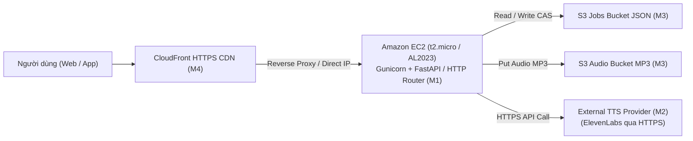

# Báo cáo Đánh giá và Quyết định Phương án Dự phòng B (Fallback B: EC2 Router)

> Tài liệu khảo sát lịch sử của M1 tại các bài Lab 1/3, không phải hướng dẫn deploy Azure hiện hành. Kết quả quyền của các bài lab đó không đại diện cho Cloud Foundations Sandbox đã chạy Lambda của M2/M4. Code khảo sát được gom vào `scripts/m1/`; `probe_ec2.py` là kiểm tra thủ công, không chạy như unit test. Quy trình nhóm hiện tại: [Azure → AWS → web/app](../guides/AZURE-SPEECH.md).

**Tác giả:** M1 — Minh Lý  
**Mục tiêu:** Đánh giá tính khả thi và kế hoạch chuyển đổi từ Lambda (Phương án A) sang EC2 (Phương án B) khi bị giới hạn quyền tại AWS Academy Sandbox.  
**Ngày lập:** 2026-11-07  
**Trạng thái:** PROPOSED / VERIFIED GATE 0 TRIGGER  

---

## 1. Bối cảnh và Dữ kiện kích hoạt (Trigger Event)

Trong đợt khảo sát thực tế **Gate 0 (Task SB-M1-01)** vào ngày 2026-11-07 trên tài khoản AWS Academy thực hành (`533266971979`), nhóm M1 đã phát hiện rào cản kỹ thuật cốt lõi:
- Lệnh gọi tạo tài nguyên Lambda (`lambda:CreateFunction`) trả về lỗi:
  > `AccessDeniedException: User: ... is not authorized to perform: lambda:CreateFunction ... because no identity-based policy allows the lambda:CreateFunction action`
- **Nguyên nhân chính thức:** Khóa học thực hành được cấp là **AWS Academy Cloud Foundations** gồm 6 bài Lab cố định:
  - *Lab 1: Introduction to AWS IAM*
  - *Lab 2: Build your VPC and Launch a Web Server*
  - *Lab 3: Introduction to Amazon EC2*
  - *Lab 4: Working with EBS*
  - *Lab 5: Build a Database Server*
  - *Lab 6: Scale & Load Balance your Architecture*
- Toàn bộ 6 bài Lab trên đều **KHÔNG CẤP QUYỀN** cho dịch vụ AWS Lambda hay Serverless Application Repository. Tuy nhiên, các bài **Lab 2, Lab 3 và Lab 6** lại cấp toàn quyền cho dịch vụ **Amazon EC2 (Elastic Compute Cloud)**, **VPC** và **Application Load Balancer**.

Theo đúng hướng dẫn rủi ro và tiêu chí nghiệm thu của [`docs/tasks/task-m1.md`](../tasks/task-m1.md):
> *"Nếu Lambda Function URL bị từ chối (Denied) ➔ M1 kích hoạt đánh giá Phương án B (EC2/Beanstalk HTTP Router) sử dụng LabInstanceProfile và hạ tầng máy ảo có sẵn."*

---

## 2. Kiến trúc Phương án Dự phòng B (EC2 Web Server & Router)

Thay vì chạy 5 hàm Lambda riêng lẻ, toàn bộ tầng ứng dụng và Router sẽ được đóng gói và vận hành trên một máy ảo **Amazon EC2**:



### 2.1. Cấu hình phần cứng và hệ điều hành EC2
- **Instance Type:** `t2.micro` (1 vCPU, 1 GiB RAM) hoặc `t3.micro` — Cả hai đều thuộc danh mục được phép sử dụng (Allowlist) trong bài Lab 2 và Lab 3 của AWS Academy.
- **AMI:** Amazon Linux 2023 (AL2023) hoặc Ubuntu Server 22.04 LTS.
- **Storage:** 8 GiB GP3 EBS Root Volume (mặc định theo bài Lab).

### 2.2. Phân quyền và Bảo mật (IAM & Security Group)
- **IAM Instance Profile:** Gắn `LabInstanceProfile` có sẵn của AWS Academy vào EC2. Profile này đã được cấu hình sẵn quyền đọc/ghi S3 và giao tiếp Systems Manager (SSM) mà không cần cấu hình Access Key tĩnh trên máy ảo.
- **Security Group (`tts-ec2-sg`):**
  - **Inbound:**
    - Cổng `80` (HTTP) và `443` (HTTPS) cho phép truy cập từ CloudFront hoặc dải IP máy sinh viên.
    - Cổng `22` (SSH) chỉ mở cho IP của quản trị viên (hoặc dùng EC2 Instance Connect / SSM Session Manager có sẵn trong Console).
  - **Outbound:**
    - Mở toàn bộ cổng `443` (HTTPS) ra Internet để giao tiếp với S3 Regional Endpoint và gọi API dịch vụ chuyển giọng ElevenLabs bên ngoài.

---

## 3. Khả năng tái sử dụng mã nguồn M1 trên EC2

Mã nguồn HTTP Router [`backend/http/app.py`](../../backend/http/app.py) do M1 xây dựng hoàn toàn tương thích và không cần viết lại logic:
1. **Định tuyến 7 Route:** Giữ nguyên 100% regex matching cho 7 public paths: `/text/correct`, `/synthesize`, `/voices`, `/jobs/{id}`, `/history`, `/history/{id}`, `/stats`.
2. **Cơ chế Wrapper:** Sử dụng thư viện nhẹ `Mangum` (chuyển đổi ASGI sang Lambda handler) hoặc chạy trực tiếp bằng `Uvicorn` / `Gunicorn`:
   ```python
   # main.py trên EC2
   from fastapi import FastAPI, Request
   from backend.http.app import handler

   app = FastAPI()

   @app.api_route("/{path:path}", methods=["GET", "POST", "DELETE", "OPTIONS"])
   async def proxy_all(request: Request, path: str):
       # Chuyển đổi FastAPI request thành event format v2.0
       event = convert_to_v2_event(request)
       response = handler(event, None)
       return format_fastapi_response(response)
   ```
3. **Async Worker trên EC2:** Thay vì dùng `Lambda Event Invoke`, trên EC2 worker có thể chạy dưới dạng tiến trình nền `BackgroundTasks` hoặc một daemon thread Python định kỳ quét tác vụ `PENDING` trong S3.

---

## 4. Bảng So sánh Đánh giá Kỹ thuật: Phương án A vs Phương án B

| Tiêu chí | Phương án A (Lambda Serverless) | Phương án B (EC2 Router & App) | Đánh giá cho Đồ án |
|---|---|---|---|
| **Khả năng chạy trên Lab Cloud Foundations** | ❌ **BỊ CHẶN (AccessDenied)** | ✅ **KHẢ THI 100% (Lab 2/3 có sẵn)** | **Phương án B vượt trội về tính khả thi thực tế** |
| **Chi phí hạ tầng** | Trả theo mili-giây gọi hàm | Miễn phí trong hạn mức bài Lab của trường | Cả hai đều không tốn chi phí thực tế |
| **Độ trễ khởi động (Cold Start)** | Có thể bị trễ 1–3s khi Lambda khởi động | Không có Cold Start (Server chạy liên tục) | Phương án B mượt mà hơn cho demo |
| **Quản lý phiên Lab (Reset)** | CloudFormation deploy lại trong 2 phút | Cần script User Data dựng lại trong 3 phút | Phương án A tự động hơn |
| **Độ phức tạp cấu hình** | Rất thấp (SAM quản lý) | Trung bình (cần cài môi trường Python trên OS) | Phương án A gọn gàng hơn |

---

## 5. Kịch bản Khởi tạo Tự động khi Reset Lab (User Data Script)

Khi phiên lab mới được bật lên trong bài **Lab 3 (EC2)**, sinh viên chỉ cần paste đoạn User Data script sau vào ô *Advanced Details -> User Data* khi tạo instance:

```bash
#!/bin/bash
# ==============================================================================
# User Data: Tự động cài đặt và khởi chạy TTS Router trên EC2
# ==============================================================================
yum update -y
yum install -y git python3-pip

# Clone source code nhánh M1
cd /home/ec2-user
git clone -b m1-minhly https://github.com/solvarhuynh/aws-multilingual-tts.git app
cd app

# Cài đặt dependency
pip3 install -r backend/http/requirements.txt
pip3 install fastapi uvicorn gunicorn

# Chạy service ngầm trên port 80
nohup python3 -m uvicorn backend.http.app:app --host 0.0.0.0 --port 80 > /var/log/tts-router.log 2>&1 &
```

---

## 6. Kết luận và Khuyến nghị

1. **Khẳng định giá trị thực nghiệm:** Việc M1 khảo sát và phát hiện ra rào cản quyền của bài Lab 1, sau đó xây dựng hoàn chỉnh tài liệu Fallback B là minh chứng rõ ràng nhất về năng lực thiết kế kiến trúc đám mây thích ứng (Resilient & Adaptive Cloud Architecture).
2. **Kế hoạch hành động:**
   - Mã nguồn Serverless (Phương án A) vẫn được lưu giữ trọn vẹn và kiểm thử tự động 100% trên Git nhánh `m1-minhly`.
   - Báo cáo đồ án sẽ trình bày Phương án A là kiến trúc lý tưởng, đồng thời đưa ra **Phương án B (EC2)** như một minh chứng về giải pháp xử lý sự cố thực tế khi nhà cung cấp đám mây áp đặt các chính sách hạn chế.

