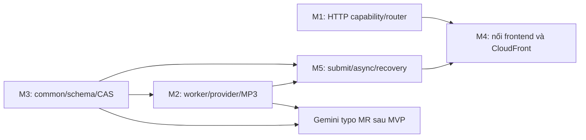

# Bàn giao và thứ tự phối hợp M1–M5

Tài liệu này chỉ tóm tắt thứ tự phụ thuộc giữa module. **Phạm vi việc và tiêu chí nghiệm thu chính thức nằm trong task của từng thành viên**: [M1](../tasks/task-m1.md), [M2](../tasks/task-m2.md), [M3](../tasks/task-m3.md), [M4](../tasks/task-m4.md), [M5](../tasks/task-m5.md). Không dùng file này như checklist thay cho task hoặc bằng chứng đã làm.

## Thứ tự phụ thuộc

Thứ tự này là phụ thuộc kỹ thuật, không yêu cầu phải chờ toàn bộ một module mới được bắt đầu việc độc lập. Mỗi người xác nhận interface với owner liên quan trước khi code.

## Bàn giao giữa module

| Bên giao | Bàn giao | Bên nhận |
|---|---|---|
| M3 | Job schema, common repository, conditional update/CAS, paging và storage interface | M2 worker; M5 submit/recovery; M4 history/polling integration |
| M2 | Voice registry, worker input/output, provider result, timeout/error behavior và retry proposal | M1 route map; M5 async dispatch; M4 voice selection |
| M5 | Submit response `202`, job ID, async event contract, validation và telemetry fields | M1 routing; M4 UI/polling; M2 worker event |
| M1 | HTTP route map, request context, URL/origin details và root infrastructure outputs | M4 frontend/API integration; các owner Lambda |
| M4 | Frontend request/response mapping, hosting URL/cache behavior và redeploy handoff | Cả nhóm kiểm thử tích hợp |

Ranh giới tài nguyên: M1 sở hữu Function URL và resource policy; M4 sở hữu CloudFront distribution/OAC association; M2 sở hữu một `EventInvokeConfig` cho worker; M5 đề xuất retry/event-age/destination policy nhưng không tạo cấu hình trùng. S3 web của M4 tách khỏi S3 jobs/audio của M3.

## Các mốc kiểm soát

1. **Contract:** nhóm xác nhận API/data/auth proposal trước khi đổi public behavior.
2. **Capability:** chỉ chọn kiến trúc AWS sau khi action/principal cần thiết được kiểm tra theo [service matrix](SANDBOX-SERVICE-MATRIX.md); tên service trong allowlist không chứng minh quyền.
3. **Implementation:** M3 common/schema trước các caller M2/M5; M1 xác nhận HTTP entry trước khi M4 nối API; M2 tạo MP3 MVP trước MR Gemini.
4. **Tích hợp:** unit/mock tests chạy không gọi AWS/provider mặc định; sandbox E2E là bước riêng, theo yêu cầu cụ thể và [validation runbook](SANDBOX-VALIDATION-RUNBOOK.md).
5. **Bàn giao:** task chỉ hoàn tất khi owner ghi output và bằng chứng phù hợp vào log. Phân biệt planned, coded, locally tested, sandbox verified, deployed & demoed.

## Ngoài baseline hiện tại

Gemini typo là MR sau MVP, chỉ đề xuất sửa lỗi đánh máy và cần người dùng chấp nhận; lỗi provider thì giữ nguyên văn bản. Polly, DynamoDB, API Gateway, SQS/DLQ, Secrets Manager, Comprehend/Translate, Cognito, X-Ray/RUM, EventBridge và Budgets không thuộc baseline Sandbox nếu chưa có xác nhận riêng.

Mọi kiến trúc, dependency và mốc trong file này là kế hoạch đề xuất; chưa chứng minh quyền AWS, implementation hoặc deployment.
